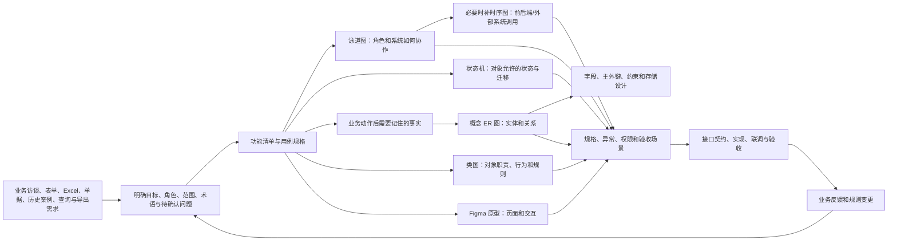
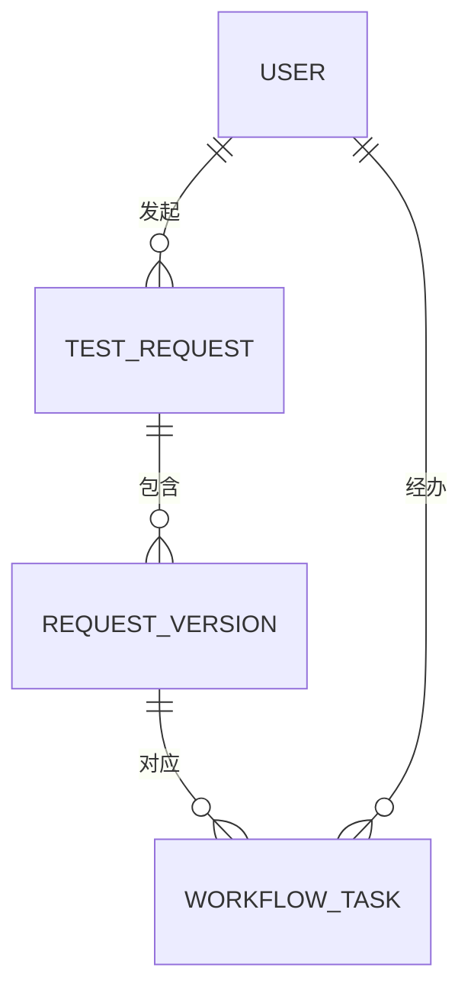
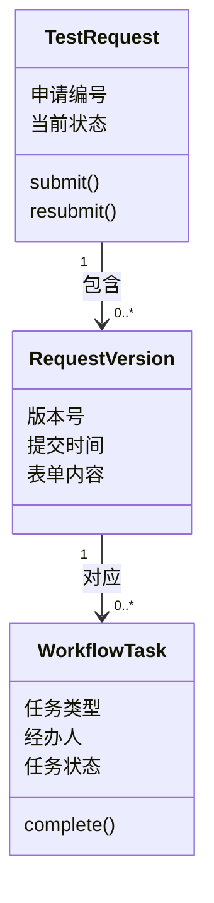

# AI时代从需求到开发的统一建模方法

## 问题 / 主题

如何把业务需求逐步整理成产品功能、流程与数据模型、前后端设计和验收标准，并用 Mermaid、Markdown、原型工具和 Git 管理设计成果，使产品、业务、开发人员及 AI Agent 能围绕同一套材料协作。

## 结论

软件设计可以沿着两条主线推进：**业务如何流转**与**系统需要记录和使用什么信息**。还需补上谁能操作、用户如何操作、系统如何与外部服务交互。

不要试图用一张图表达全部设计。先以真实业务案例和资料为输入，逐步形成：

1. 业务目标、角色、术语和待确认问题。
2. 功能清单与用例规格。
3. 主流程泳道图、关键对象状态机和必要的时序图。
4. 从表单、单据、历史、查询及导出需求推导概念 ER 图，再细化逻辑/物理数据模型。
5. 用类图讨论领域对象职责和行为规则；类与表不要求一一对应。
6. 用 Figma 等原型讨论页面交互，以验收场景验证需求、前后端契约和实现结果。
7. 将规则、图和决策记录保存在 Markdown/Git 中，按功能或业务模块归档，并维护统一编号和交叉引用。

图用于澄清结构和关系，文字规格用于固定规则、字段、权限、异常和验收条件。模型是业务讨论工具，不能替代业务确认。

## 建模流程



## 各种模型回答的问题

| 表达方式 | 主要回答的问题 | 何时使用 |
|---|---|---|
| 业务目标与范围 | 为什么做、为谁做、哪些不在本次范围 | 项目或功能开始时 |
| 功能清单 | 系统有哪些功能、在哪个页面、由谁使用 | 拆分产品范围、安排团队工作 |
| 用例规格 | 输入、前置条件、规则、输出、权限及异常是什么 | 前后端需要对齐具体行为时 |
| 泳道图/流程图 | 哪些角色与系统按什么顺序完成工作 | 主流程涉及多人、多系统或交接时 |
| 状态机图 | 对象处于什么状态、什么事件可触发迁移 | 状态多、退回/重提/取消/补测规则复杂时 |
| ER 图 | 需要持久化哪些实体，它们如何关联 | 业务事实和历史要求已初步明确后 |
| 类图 | 业务对象具有什么职责、操作和约束 | 讨论领域行为、对象职责和规则归属时 |
| 时序图 | 一次用例中 UI、API、服务、数据库如何协作 | 联调接口、调用顺序或外部依赖需要澄清时 |
| 原型图 | 用户看到什么、如何操作、如何获得反馈 | 验证页面布局和交互前 |
| 验收场景 | 什么输入和操作应产生什么结果 | 评审需求、开发完成验收和构造测试时 |

小功能通常以**功能清单 + 用例规格 + 验收场景**为主。仅当交互、状态或系统协作不易通过文字说明时，再补对应图；不需要为了“使用 UML”而为每个功能画全套图。

## 从流程推导数据模型

流程图回答“发生了什么”，数据模型还要回答“发生后要保存什么、历史是否保留、以后怎么查询”。建模时先观察一笔真实业务，不要只根据屏幕字段直接建表。

### 数据调研输入

- 创建、提交、退回、重提、审批、改派等业务案例。
- 表单、Excel、业务单据、附件及外部系统数据。
- 待办、历史查询、审计、统计、报表和导出需求。
- 用户对历史版本、责任人、意见、时间和追溯能力的要求。

围绕每个动作追问：**动作发生以后，系统需要长期记住什么事实？**再检查这些事实在状态变化后是否需要保留。

### 推导示例：测试申请退回后重提

若规则是同一申请编号延续、每次提交内容都要回看、每轮办理都需留痕，则可以先区分：

| 业务对象 | 要记录的事实 | 可能的关系 |
|---|---|---|
| 测试申请 | 稳定的申请编号、发起人、当前状态 | 有一个发起人，拥有多个提交版本 |
| 申请版本 | 某一次提交的表单内容、附件和提交时间 | 属于一份申请，可关联多个办理任务 |
| 办理任务 | 类型、经办人、状态、意见、结果和处理时间 | 对应一个版本，由用户办理 |
| 用户 | 发起或办理身份 | 可发起多份申请或办理多条任务，通常由用户/身份系统维护 |



该图只是概念模型。若支持多人会签、任务改派历史、草稿版本或部分附件继承，需要根据实际规则调整关联。随后再确定字段、主外键、约束、附件存储及版本策略。

### 类图和 ER 图的配合



- ER 图聚焦需要保存的数据和关联。
- 类图帮助讨论对象的职责、行为和规则，例如“只有已退回申请才能重提”。
- 一次重提可能需要更新申请状态、保存新版本并创建新任务；应用服务可以组织事务，领域对象负责自身规则。
- 类和数据库表不必一一对应；ER 图中的表也不必都实现成有复杂行为的领域类。

## 非流程性小功能如何建模

例如“导出申请清单”可以作为审核工作台里的独立用例。它可能有自己的输入、权限、取数范围、输出和异常，但不一定改变申请的审批状态。

| 用例规格项 | 示例：导出申请清单 |
|---|---|
| 功能编号/入口 | `F-03`；我的待审或已处理列表 |
| 使用者/权限 | 有导出权限且有权访问所选记录的审核人 |
| 输入 | 选中的任务 ID，或已确认范围的筛选条件 |
| 规则 | 后端重新验证数据范围、字段、任务状态和版本 |
| 输出 | Excel 文件或异步导出任务 |
| 异常 | 未选择、无数据、权限变化、任务已处理、生成失败 |
| 业务影响 | 只读导出时，申请、版本和任务状态保持不变 |

验收场景示例：

| 场景 | 操作 | 预期结果 |
|---|---|---|
| 正常导出 | 选择 3 条有权访问的记录并导出 | 文件包含全部 3 条且字段符合清单 |
| 未选择 | 不选记录即触发导出 | 按规格禁用操作或显示明确提示 |
| 权限/任务变化 | 页面打开后某任务被改派或完成 | 后端重新校验并返回约定的错误反馈 |
| 大批量导出 | 导出耗时较长 | 考虑创建导出任务，定义排队、生成、成功、失败状态及下载权限 |

导出主图中可标出入口，再为独立导出子流程画简单流程图或时序图。若导出只是只读辅助功能，不应误画成审批状态迁移。

## 原型、设计文档与代码的追踪

用稳定的功能编号把业务讨论、原型、接口、任务和验收连起来：

| 载体 | 示例 |
|---|---|
| 功能清单 | `F-03 导出测试申请` |
| Figma 页面 | 页面说明标记 `F-03` |
| 设计文档 | `export.md` 写明 `F-03`，包含规则和原型链接 |
| API 契约 | 标记对应功能编号和请求/响应模型 |
| 开发任务 | Issue/任务引用 `F-03` |
| 验收场景 | `AC-01`、`AC-02` 对应 `F-03` |

## 设计资料归档与团队/Agent协作

对小型团队，建议以 **Markdown + Mermaid + Git** 作为规则、表格、图源码和变更历史的共同基础；Figma 用于页面原型；需要复杂拖拽排版的泳道图时可配合 draw.io。在线工具是否可用应符合团队的数据和安全要求。

可按业务功能组织，而不是按“所有 ER 图”“所有泳道图”分目录：

```text
docs/
  README.md                 # 业务模块目录、负责人、状态
  test-request/
    overview.md             # 范围、角色、术语、主流程
    approval.md             # 审批流程、状态机和规则
    export.md               # 导出用例、权限、异常和验收
    data-model.md           # 概念 ER、字段和历史版本策略
    permissions.md          # 操作权限和数据范围
    decisions.md            # 重要决定、原因和影响
```

维护约定：

1. 调研时记录目标、业务规则和待确认问题，明确草稿/已确认状态。
2. 业务评审后更新规则和图，并记录重要决定及原因。
3. 代码变更影响规则、状态或接口时，在同一评审中更新文档。
4. 文档以已合并版本为准，Git 保留历史。
5. 图的源码与讲解放在对应功能文档附近；复杂原生画布文件保留可编辑源文件。
6. 为 Agent 提供模块职责、术语、接口契约、状态迁移、目录入口和开发约束，要求改代码时同步检查相关设计。

不要过度设计文档结构。每张图应服务一个明确问题；文字表格应补足图难以表达的字段、权限、失败语义和验收细节。

## 方案落地检查清单

- [ ] 是否从真实业务案例、表单、历史和查询需求收集输入？
- [ ] 角色、目标、范围、术语和待确认问题是否明确？
- [ ] 每项功能是否有编号、入口、使用者、规则、输出、权限和异常？
- [ ] 主流程、状态迁移和跨系统调用是否使用合适的图表达？
- [ ] 数据模型是否从业务事实及历史要求推导，并能支持实际查询？
- [ ] 类图讨论的是职责和行为，ER 图讨论的是存储关系，两者是否避免机械一一映射？
- [ ] 原型、API、开发任务和验收场景能否通过编号追踪？
- [ ] 图和规则是否与代码变更一起评审？

## 引用的页面

- 暂无

## 尚存的缺口 / 待研究

- Mermaid 特定图类型的渲染能力取决于实际使用的 Git 平台、编辑器和 Mermaid 版本，应在团队环境验证；不可渲染时保留源码并附可读导出图。
- 具体 ER 图和状态机必须结合真实业务规则确认，本文中的测试申请只是示例。
