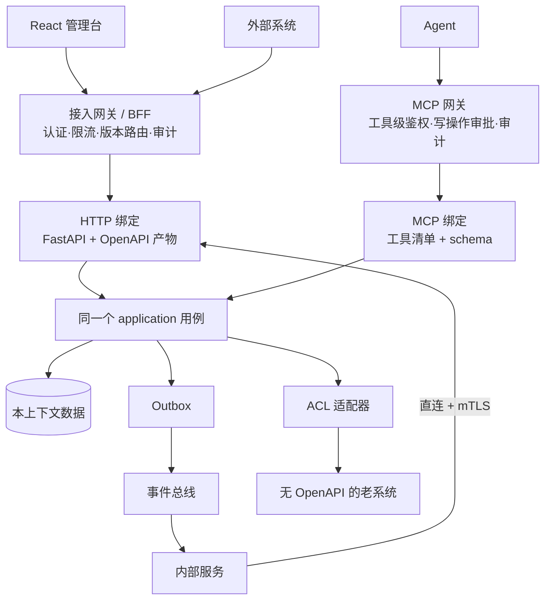
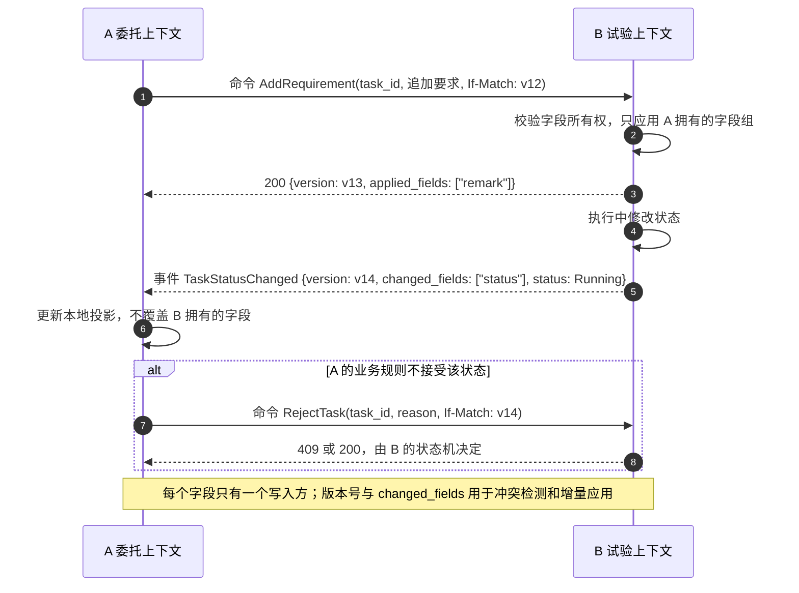
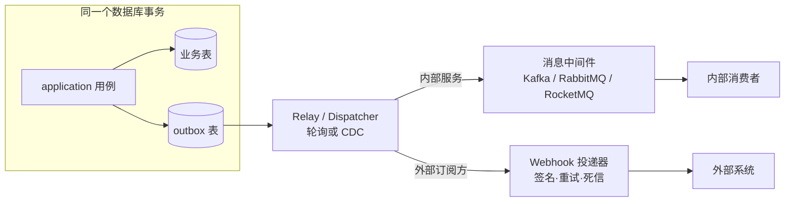
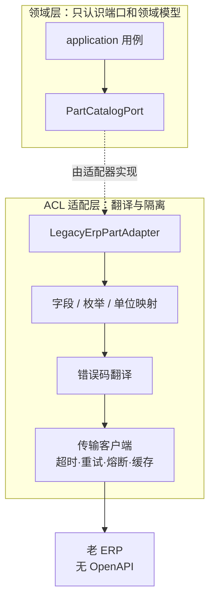

# API交互面与契约治理

> 承接 [[DDD模块边界与数据协作]] 与 [[测试业务DDD上下文划分]]。服务拆开之后，真正难的不是“有没有接口”，而是三类异构接口如何共用一套契约、版本和同步规则。

## 一、三类接口，两个维度

| 类型                             | 契约可发现性                          | 交互模式       | 典型消费方       |
| ------------------------------ | ------------------------------- | ---------- | ----------- |
| A. MCP（无 REST）                 | 运行时 `tools/list` + 版本化 manifest | 工具调用，请求/响应 | Agent、自动化流程 |
| B. 原生 HTTP（有授权、无 openapi.json） | 人工文档，机器不可读                      | 请求/响应      | 外部老系统       |
| C. FastAPI 微服务                 | 构建产物里的 openapi.json             | 请求/响应 + 事件 | 内部服务、前端、外部  |

两个维度决定治理方式：

- **契约是否机器可读**：决定能不能做代码生成、破坏性检查、契约测试。C 可以，A 可以（另一种 schema），B 不行。
- **交互是否同步**：决定用 HTTP 还是事件。同步要立即结果，异步要最终一致。

结论：不强行统一协议，但必须统一**契约仓库、版本策略、鉴权与审计**。

## 二、一个能力，一份契约，多个绑定



四条规则：

1. 业务能力只在 application 层实现一次，HTTP 和 MCP 都是适配器。
2. 绑定层不写业务规则，只做协议转换、鉴权入口和错误映射。
3. 契约产物进仓库，CI 生成与校验，不在运行时拉取。
4. 各绑定可以独立版本化，但语义必须同源，不能一边说“只读”一边允许写。

## 三、FastAPI 的 openapi.json 里到底有什么

### 3.1 顶层结构

| 字段                           | 内容                                        | FastAPI 来源                 |
| ---------------------------- | ----------------------------------------- | -------------------------- |
| `openapi`                    | 规范版本，通常是 `3.1.0`                          | 框架默认                       |
| `info`                       | title、version、description、contact、license | `FastAPI(...)` 参数          |
| `servers`                    | 部署地址与前缀                                   | `root_path` / `servers=`   |
| `tags`                       | 分组与说明                                     | 路由 `tags=`、`openapi_tags=` |
| `paths`                      | 每个路径 + 方法 + 参数 + 请求体 + 响应                 | 路由装饰器 + 函数签名               |
| `components.schemas`         | Pydantic 模型转成的 JSON Schema                | 模型定义                       |
| `components.securitySchemes` | Bearer / OAuth2 / API Key                 | `Security()` 依赖            |
| `security`                   | 全局默认鉴权要求                                  | 同上                         |

### 3.2 一个完整的例子

```json
{
  "openapi": "3.1.0",
  "info": {
    "title": "零部件试验服务",
    "version": "1.4.0",
    "description": "零部件试验上下文的 HTTP 契约。所有写操作需要 test-order:write 权限。"
  },
  "servers": [{ "url": "https://api.example.com/parts-test" }],
  "tags": [
    { "name": "master-data", "description": "主数据查询（只读）" },
    { "name": "test-order", "description": "试验委托与任务" }
  ],
  "paths": {
    "/v1/parts/{part_no}": {
      "get": {
        "tags": ["master-data"],
        "summary": "查询零件",
        "description": "按零件号查询零件主数据。只读操作。零件不存在时返回 404。",
        "operationId": "get_part_v1_parts__part_no__get",
        "parameters": [
          {
            "name": "part_no",
            "in": "path",
            "required": true,
            "description": "零件号，格式 P-年份-五位流水号",
            "schema": { "type": "string", "pattern": "^P-\\d{4}-\\d{5}$" }
          }
        ],
        "responses": {
          "200": {
            "description": "成功",
            "content": {
              "application/json": {
                "schema": { "$ref": "#/components/schemas/Part" }
              }
            }
          },
          "404": {
            "description": "零件不存在",
            "content": {
              "application/json": {
                "schema": { "$ref": "#/components/schemas/Error" }
              }
            }
          },
          "422": {
            "description": "参数校验失败",
            "content": {
              "application/json": {
                "schema": { "$ref": "#/components/schemas/HTTPValidationError" }
              }
            }
          }
        }
      }
    },
    "/v1/test-orders": {
      "post": {
        "tags": ["test-order"],
        "summary": "创建试验委托",
        "description": "创建委托并进入受理流程。写操作。相同 Idempotency-Key 的重复请求返回同一结果。",
        "operationId": "create_test_order_v1_test_orders_post",
        "requestBody": {
          "required": true,
          "content": {
            "application/json": {
              "schema": { "$ref": "#/components/schemas/TestOrderCreate" }
            }
          }
        },
        "responses": {
          "201": {
            "description": "创建成功",
            "content": {
              "application/json": {
                "schema": { "$ref": "#/components/schemas/TestOrder" }
              }
            }
          },
          "409": {
            "description": "委托号冲突或幂等键被占用",
            "content": {
              "application/json": {
                "schema": { "$ref": "#/components/schemas/Error" }
              }
            }
          },
          "422": {
            "description": "参数校验失败",
            "content": {
              "application/json": {
                "schema": { "$ref": "#/components/schemas/HTTPValidationError" }
              }
            }
          }
        }
      }
    }
  },
  "components": {
    "schemas": {
      "Part": {
        "type": "object",
        "title": "Part",
        "description": "零件主数据快照。字段含义与主数据系统一致。",
        "properties": {
          "part_no": { "type": "string", "description": "零件号" },
          "name": { "type": "string", "description": "零件名称" },
          "drawing_no": {
            "type": ["string", "null"],
            "description": "图号，无图号时为空"
          },
          "version": { "type": "string", "description": "主数据版本号" },
          "status": {
            "type": "string",
            "enum": ["active", "obsolete"],
            "description": "状态。obsolete 表示已停用，新委托不应引用"
          }
        },
        "required": ["part_no", "name", "status"]
      },
      "TestOrderCreate": {
        "type": "object",
        "title": "TestOrderCreate",
        "properties": {
          "part_no": {
            "type": "string",
            "pattern": "^P-\\d{4}-\\d{5}$",
            "description": "零件号"
          },
          "standard_code": { "type": "string", "description": "试验标准编号" },
          "standard_version": {
            "type": "string",
            "description": "标准版本，必须与主数据当前发布版本一致"
          },
          "items": {
            "type": "array",
            "items": { "type": "string" },
            "minItems": 1,
            "description": "试验项目列表，至少一项"
          }
        },
        "required": ["part_no", "standard_code", "standard_version", "items"]
      },
      "TestOrder": {
        "type": "object",
        "properties": {
          "order_no": { "type": "string", "description": "委托号" },
          "status": {
            "type": "string",
            "enum": ["accepted", "scheduled", "testing", "completed", "cancelled"]
          },
          "created_at": { "type": "string", "format": "date-time" }
        },
        "required": ["order_no", "status", "created_at"]
      },
      "Error": {
        "type": "object",
        "properties": {
          "code": { "type": "string", "description": "稳定错误码，供程序判断" },
          "message": { "type": "string", "description": "人类可读说明" },
          "trace_id": { "type": "string", "description": "链路追踪 ID" }
        },
        "required": ["code", "message"]
      },
      "HTTPValidationError": {
        "type": "object",
        "properties": {
          "detail": {
            "type": "array",
            "items": {
              "type": "object",
              "properties": {
                "loc": { "type": "array", "items": { "type": "string" } },
                "msg": { "type": "string" },
                "type": { "type": "string" }
              }
            }
          }
        }
      }
    },
    "securitySchemes": {
      "bearerAuth": {
        "type": "http",
        "scheme": "bearer",
        "bearerFormat": "JWT"
      }
    }
  },
  "security": [{ "bearerAuth": [] }]
}
```

### 3.3 哪些自动生成，哪些必须显式声明

| 内容 | 来源 | 是否自动 |
|---|---|---|
| 路径、方法、参数、请求体 | 路由与函数签名 | 自动 |
| 200 响应 schema | `response_model` 或返回类型标注 | 自动 |
| 422 校验错误 | 有参数或请求体时 | 自动 |
| 模型字段类型、必填、枚举、格式、约束 | Pydantic 模型 | 自动 |
| 字段说明 | `Field(description=...)` 或 `Annotated` | 自动 |
| 示例 | `Field(examples=[...])`、`Body(examples=...)` | 自动 |
| 接口简述与详细说明 | `summary=`、docstring | 自动 |
| 分组 | `tags=` | 自动 |
| 弃用标记 | `deprecated=True` | 自动 |
| 401/403/404/409/500 的错误体 | `responses={...: {"model": Error}}` | **需手写** |
| 全局鉴权方案 | `Security()` 依赖 | 部分自动，需确认 |
| 服务地址、联系方式、许可证 | `FastAPI(servers=..., contact=..., license_info=...)` | **需手写** |
| 回调、链接 | OpenAPI 支持 | FastAPI 不自动生成 |

最常见的坑：**只写了 200，没写 404/409**。调用方只能靠猜，生成的客户端也不会给错误类型。错误体还应该用稳定的 `code` 字段，而不是让人解析 `message`。

### 3.4 OpenAPI 能表达什么、不能表达什么

能表达：结构、类型、必填、枚举、格式、数值约束、字段说明、示例、状态码、鉴权方案、弃用标记、服务地址。

不能表达：

- **“什么时候该调用”**——只能写在 description 里，没有专门的语义字段。
- **副作用强弱**——没有标准字段说明“这是只读/破坏性/幂等”。
- **业务前置条件**——例如“标准版本必须已发布”“设备校准必须在有效期内”，只能写文档或靠 4xx 错误码。
- **跨字段规则**——JSON Schema 只能表达一部分条件约束。
- **运行时能力发现**——OpenAPI 是静态文档，服务新增接口不会自动通知调用方。

这几点正好是 MCP 补上的。

## 四、MCP 的结构与通讯格式

### 4.1 协议骨架

MCP 用 JSON-RPC 2.0 作为消息格式，传输层可以是 stdio，也可以是 Streamable HTTP。一次会话的生命周期是：

```text
initialize → notifications/initialized → tools/list → tools/call …
```

- 请求有 `id`，响应带回同一个 `id`；通知没有 `id`，不期待响应。
- 服务端通过 `initialize` 返回自己支持的能力（tools / resources / prompts / 是否支持 list_changed）。
- 客户端之后用 `tools/list` 发现工具，用 `tools/call` 调用。
- 所有消息都是同一种信封：`{"jsonrpc":"2.0","id":...,"method":...,"params":...}`。

如果这套 MCP 真的是“无 HTTP 接口”（只走 stdio 或进程内），它就无法被 HTTP 网关直接寻址；多消费方共享时要加一个 MCP 网关进程，向外提供 Streamable HTTP，向内管理鉴权和审计。

### 4.2 初始化

请求：

```json
{
  "jsonrpc": "2.0",
  "id": 1,
  "method": "initialize",
  "params": {
    "protocolVersion": "2025-06-18",
    "capabilities": {
      "roots": { "listChanged": true },
      "sampling": {}
    },
    "clientInfo": { "name": "test-center-agent", "version": "1.2.0" }
  }
}
```

响应：

```json
{
  "jsonrpc": "2.0",
  "id": 1,
  "result": {
    "protocolVersion": "2025-06-18",
    "capabilities": {
      "tools": { "listChanged": true },
      "resources": { "subscribe": true, "listChanged": true }
    },
    "serverInfo": { "name": "test-center-mcp", "version": "1.0.0" }
  }
}
```

随后客户端发通知：

```json
{ "jsonrpc": "2.0", "method": "notifications/initialized" }
```

### 4.3 工具发现：`tools/list`

请求：

```json
{ "jsonrpc": "2.0", "id": 2, "method": "tools/list", "params": {} }
```

响应（只取一个读工具和一个写工具为例）：

```json
{
  "jsonrpc": "2.0",
  "id": 2,
  "result": {
    "tools": [
      {
        "name": "get_part",
        "title": "查询零件主数据",
        "description": "按零件号查询零件主数据。只读操作。返回零件名称、图号、版本和状态。当用户询问某个零件的名称、图号或版本时使用；需要修改零件时不要用这个工具。",
        "inputSchema": {
          "type": "object",
          "properties": {
            "part_no": {
              "type": "string",
              "description": "零件号，例如 P-2026-00123",
              "pattern": "^P-\\d{4}-\\d{5}$"
            }
          },
          "required": ["part_no"],
          "additionalProperties": false
        },
        "outputSchema": {
          "type": "object",
          "properties": {
            "part_no": { "type": "string" },
            "name": { "type": "string" },
            "drawing_no": { "type": ["string", "null"] },
            "version": { "type": "string" },
            "status": { "type": "string", "enum": ["active", "obsolete"] }
          },
          "required": ["part_no", "name", "status"]
        },
        "annotations": {
          "readOnlyHint": true,
          "destructiveHint": false,
          "idempotentHint": true,
          "openWorldHint": false
        }
      },
      {
        "name": "create_test_order",
        "title": "创建试验委托",
        "description": "为指定零件创建试验委托。写操作，需要 test-order:write 权限。调用前应确认零件号和标准版本；相同 idempotency_key 的重复调用返回同一委托。",
        "inputSchema": {
          "type": "object",
          "properties": {
            "part_no": { "type": "string", "description": "零件号" },
            "standard_code": { "type": "string", "description": "试验标准编号" },
            "standard_version": { "type": "string", "description": "标准版本" },
            "items": {
              "type": "array",
              "items": { "type": "string" },
              "minItems": 1,
              "description": "试验项目列表"
            },
            "idempotency_key": {
              "type": "string",
              "description": "幂等键，建议使用 UUID；重试时保持不变"
            }
          },
          "required": [
            "part_no",
            "standard_code",
            "standard_version",
            "items",
            "idempotency_key"
          ],
          "additionalProperties": false
        },
        "annotations": {
          "readOnlyHint": false,
          "destructiveHint": false,
          "idempotentHint": true,
          "openWorldHint": false
        }
      }
    ],
    "nextCursor": null
  }
}
```

### 4.4 工具调用：读

请求：

```json
{
  "jsonrpc": "2.0",
  "id": 42,
  "method": "tools/call",
  "params": {
    "name": "get_part",
    "arguments": { "part_no": "P-2026-00123" }
  }
}
```

响应：

```json
{
  "jsonrpc": "2.0",
  "id": 42,
  "result": {
    "content": [
      {
        "type": "text",
        "text": "零件 P-2026-00123：前副车架，图号 3412001-XX，版本 B，状态 active"
      }
    ],
    "structuredContent": {
      "part_no": "P-2026-00123",
      "name": "前副车架",
      "drawing_no": "3412001-XX",
      "version": "B",
      "status": "active"
    },
    "isError": false
  }
}
```

`content` 是给模型看的自然语言或富内容；`structuredContent` 是按 `outputSchema` 校验的结构化结果，给程序和模型都能用。

### 4.5 工具调用：写

请求：

```json
{
  "jsonrpc": "2.0",
  "id": 43,
  "method": "tools/call",
  "params": {
    "name": "create_test_order",
    "arguments": {
      "part_no": "P-2026-00123",
      "standard_code": "GB-T-1234",
      "standard_version": "2025",
      "items": ["salt-spray", "vibration"],
      "idempotency_key": "5b0f3c1e-7a2d-4c9e-9f10-2d6a8b7c4e21"
    }
  }
}
```

响应：

```json
{
  "jsonrpc": "2.0",
  "id": 43,
  "result": {
    "content": [
      { "type": "text", "text": "已创建委托 TO-2026-0001，状态 accepted" }
    ],
    "structuredContent": {
      "order_no": "TO-2026-0001",
      "status": "accepted",
      "created_at": "2026-11-24T10:12:00+08:00"
    },
    "isError": false
  }
}
```

### 4.6 错误：两种层次

**工具执行失败**——协议层成功，业务层失败，用 `isError: true`：

```json
{
  "jsonrpc": "2.0",
  "id": 43,
  "result": {
    "content": [
      { "type": "text", "text": "创建失败：零件 P-2026-99999 不存在" }
    ],
    "isError": true
  }
}
```

**协议层错误**——参数不合法、方法不存在等，用 JSON-RPC 的 `error`：

```json
{
  "jsonrpc": "2.0",
  "id": 43,
  "error": {
    "code": -32602,
    "message": "Invalid params",
    "data": {
      "field": "part_no",
      "reason": "pattern mismatch"
    }
  }
}
```

标准错误码：`-32700` 解析失败、`-32600` 非法请求、`-32601` 方法不存在、`-32602` 参数不合法、`-32603` 内部错误。

这条区分很重要：**模型应该看到“业务失败”并据此调整，而不是看到“协议坏了”**。工具内部校验失败、找不到记录、权限不足，都应该走 `isError`，让 Agent 有恢复空间；只有信封本身错了才用 JSON-RPC error。

### 4.7 资源与提示

工具是“动作”，资源和提示是“上下文”：

```json
{ "jsonrpc": "2.0", "id": 5, "method": "resources/list", "params": {} }
```

```json
{
  "jsonrpc": "2.0",
  "id": 5,
  "result": {
    "resources": [
      {
        "uri": "mdm://parts/P-2026-00123",
        "name": "零件 P-2026-00123",
        "mimeType": "application/json",
        "description": "零件主数据只读快照"
      }
    ]
  }
}
```

```json
{
  "jsonrpc": "2.0",
  "id": 6,
  "method": "resources/read",
  "params": { "uri": "mdm://parts/P-2026-00123" }
}
```

```json
{
  "jsonrpc": "2.0",
  "id": 6,
  "result": {
    "contents": [
      {
        "uri": "mdm://parts/P-2026-00123",
        "mimeType": "application/json",
        "text": "{\"part_no\":\"P-2026-00123\",\"name\":\"前副车架\",\"status\":\"active\"}"
      }
    ]
  }
}
```

`prompts/list` 与 `prompts/get` 用于暴露可复用的提示模板，例如“生成试验报告摘要”。它不执行动作，只是给 Agent 一段带参数的指令。

### 4.8 语义层：description 与 annotations

这是 MCP 和 OpenAPI 最大的差异：

- **`description` 直接影响模型选不选这个工具**。要写清“什么时候用、什么时候不用、返回什么、有什么前提”，而不是只写字段说明。
- **`title`** 是给人看的短名，方便审批界面和日志。
- **`annotations`** 是副作用提示：`readOnlyHint`（只读）、`destructiveHint`（可能破坏数据）、`idempotentHint`（重复调用结果一致）、`openWorldHint`（是否会访问外部世界）。客户端可以据此决定是否要求人工确认。
- **`inputSchema` / `outputSchema`** 是结构约束，和 OpenAPI 的 JSON Schema 同源，但 MCP 在运行时发现，OpenAPI 是静态文档。

## 五、OpenAPI 与 MCP 对照

| 维度 | OpenAPI | MCP |
|---|---|---|
| 面向对象 | 人、代码生成器、网关 | LLM / Agent 运行时 |
| 契约位置 | 仓库里的静态文档 | 运行时 `tools/list` + 仓库 manifest |
| 结构描述 | `components.schemas` | `inputSchema` / `outputSchema` |
| 语义描述 | summary / description / example，人读 | description 直接影响模型选择；title；annotations |
| 副作用提示 | 无标准字段 | readOnlyHint / destructiveHint / idempotentHint / openWorldHint |
| 错误 | HTTP 状态码 + 错误 schema | `isError` 结果 + JSON-RPC error |
| 鉴权 | securitySchemes | 传输层 + 应用层策略，工具级 scope 自建 |
| 发现 | registry / 版本化制品 | `initialize` + `tools/list`，可分页 |
| 版本 | URL major + 字段 deprecated | 工具名 + schema + protocolVersion |
| 适合 | 确定性集成、批量、前端 | 模型自主选择工具、自然语言驱动 |

一句话：**OpenAPI 描述“怎么调”，MCP 额外描述“为什么调、能不能调、调了有什么后果”**。同一能力做两套绑定时，用例和字段说明应该同源，避免两边说法不一致。

## 六、双向读写：你说的“双通道”

这里的“双通道”不是“推送 + 拉取对账”，而是**双向读写**：A 推给 B，B 修改字段或状态，A 要收到 B 的修改；A 还可能补充内容给 B。核心风险不是网络，而是**同一个字段有两个写入方**。

### 6.1 三种建模方式，按优先级

1. **字段所有权（推荐）**：一条跨边界记录按字段组切分，每组只有一个写入方。A 的“补充”是命令，B 的“回写”是事件。没有字段被两边同时写。
2. **状态机分层**：A 拥有业务主状态（受理、取消），B 拥有执行子状态（排队、运行、完成、中止）。A 不直接改子状态，只发命令；B 决定是否接受。
3. **共享聚合（最差解，跨服务避免）**：如果确实要共同编辑同一组字段，只能有一个 owner，另一方用命令 + 投影；或者把这段协作收进同一个上下文。跨服务共享写会把并发冲突变成分布式问题。

### 6.2 字段所有权矩阵（以试验任务为例）

| 字段组 | 权威方 | 另一方怎么用 |
|---|---|---|
| 委托需求：零件号、标准版本、项目清单 | A 委托上下文 | B 只读，创建时保存快照 |
| 执行状态：排队 / 运行 / 完成 / 中止 | B 试验上下文 | A 只读，通过事件更新投影 |
| 结果摘要：结论、报告链接 | B | A 只读 |
| 补充说明：客户备注、追加要求 | A | B 只读 |
| 设备快照：台架编号、校准版本 | B | A 只读，报告引用 |

规则：**A 的“补充内容”只能写 A 拥有的字段组**。如果 A 要影响 B 的执行，发命令（如 `AddRequirement`、`CancelTask`），由 B 校验后决定是否应用；不要直接 PATCH B 的整条记录。

### 6.3 时序



### 6.4 冲突、回环与对账

- **版本控制**：写请求带 `If-Match: "v12"`，版本不匹配返回 `409 Conflict` 和当前版本；客户端刷新后重试。
- **事件增量**：事件带 `aggregate_version` 和 `changed_fields`，消费方只应用自己关心的字段，旧版本事件直接丢弃。
- **回环检测**：命令带 `command_id`，B 的事件带 `causation_id`；A 识别出“这是我自己命令的结果”时只更新投影，不再发新命令。
- **双向对账**：定期比对两边关键字段和版本号，输出差异报告；不要假设事件永不丢。
- **审计**：谁在什么时候改了哪个字段，两边都要留；冲突解决过程也要留。
- **Last-write-wins 只在“同一字段、低频、可接受丢失”时使用**，并显式记录，不要当成默认策略。

### 6.5 对方没有事件能力时

- 有查询 API：游标轮询 + 定期对账。
- 有 webhook：订阅 + 签名校验 + 重试。
- 只有批量文件：快照 + diff。
- 都没有：定时同步 + 差异报告，不要假装实时。

## 七、Outbox：可靠投递，不是事件类型

先纠正一个常见混淆：**Outbox 不是“事件处理类型”，也不是“状态同步”或“消息订阅”本身**。它是让“写业务数据”和“发事件”原子化的可靠性机制。三个维度是正交的：

| 维度 | 回答的问题 | 例子 |
|---|---|---|
| 事件语义 | 这条事件表达什么 | 状态同步、通知、主数据变更 |
| 可靠性机制 | 怎么保证事件不丢 | Outbox、重试、幂等、死信 |
| 投递通道 | 事件走哪条路 | 消息中间件、Webhook |

“状态同步”和“消息订阅”是**目的**；“消息中间件”和“Webhook”是**通道**；Outbox 是**保证**。三者可以任意组合，不要混为一谈。

### 7.1 它解决什么问题

没有 Outbox 时，代码通常长这样：

```python
order.status = "accepted"
db.commit()                        # 成功
mq.publish("TestOrderAccepted")    # 失败：事件丢了，下游永远不知道
```

反过来先发消息再提交，又可能发出一个事务已回滚的假事件。Outbox 把待发事件写进**同一个数据库事务**：

```python
with db.transaction():
    db.save(order)
    db.insert(outbox_event(...))
```

事务成功，事件一定在表里；事务回滚，事件也不会出现。之后由独立的 relay 负责投递。业务代码不再直接调用消息中间件或 Webhook。



### 7.2 Outbox 表怎么建

```sql
CREATE TABLE outbox_event (
  id              UUID PRIMARY KEY,
  aggregate_type  VARCHAR(64)  NOT NULL,
  aggregate_id    VARCHAR(64)  NOT NULL,
  event_type      VARCHAR(128) NOT NULL,
  event_version   INT          NOT NULL DEFAULT 1,
  payload         JSONB        NOT NULL,
  headers         JSONB        NOT NULL DEFAULT '{}',
  occurred_at     TIMESTAMPTZ  NOT NULL DEFAULT now(),
  available_at    TIMESTAMPTZ  NOT NULL DEFAULT now(),
  status          VARCHAR(16)  NOT NULL DEFAULT 'pending',
  attempts        INT          NOT NULL DEFAULT 0,
  last_error      TEXT,
  published_at    TIMESTAMPTZ,
  locked_by       VARCHAR(64),
  locked_until    TIMESTAMPTZ
);

CREATE INDEX idx_outbox_pending
  ON outbox_event (status, available_at);
```

几个字段的作用：

- `id`：事件 ID，也是消费方的幂等键。
- `aggregate_type` / `aggregate_id`：聚合标识，用于分区、排序和重放。
- `event_type` / `event_version`：契约标识。
- `payload`：业务数据，只放对外稳定的字段，不要塞 ORM 对象。
- `headers`：`correlation_id`、`causation_id`、`trace_id`。
- `available_at`：延迟投递或退避重试的时间。
- `status` / `attempts` / `last_error`：投递状态。
- `locked_by` / `locked_until`：多个 relay 实例互斥，崩溃后锁过期自动被接管。

### 7.3 Relay 的两种实现

| 方式 | 原理 | 优点 | 代价 |
|---|---|---|---|
| 轮询 | 定时 `SELECT ... FOR UPDATE SKIP LOCKED` | 简单、可控、易调试 | 有延迟、增加数据库压力 |
| CDC | Debezium 等读 binlog / WAL | 低延迟、对业务表无侵入 | 运维重、需要理解位点和快照 |

轮询版的核心 SQL：

```sql
SELECT *
FROM outbox_event
WHERE status = 'pending' AND available_at <= now()
ORDER BY occurred_at
LIMIT 100
FOR UPDATE SKIP LOCKED;
```

`SKIP LOCKED` 让多个 relay 并发拉取时不会抢同一条；投递成功后标记 `published`，失败则增加 `attempts` 并按指数退避更新 `available_at`。

### 7.4 事件信封

不要只发 payload，信封要带齐这些字段：

```json
{
  "event_id": "0f5c1f5e-3f0a-4b7e-9f2a-6d1c8e4b9a10",
  "event_type": "TestOrderAccepted",
  "event_version": 1,
  "occurred_at": "2026-11-24T10:12:00+08:00",
  "producer": "test-order-service",
  "aggregate_type": "TestOrder",
  "aggregate_id": "TO-2026-0001",
  "correlation_id": "c-123",
  "causation_id": "cmd-456",
  "payload": {
    "order_no": "TO-2026-0001",
    "part_no": "P-2026-00123",
    "status": "accepted"
  }
}
```

消费方靠 `event_id` 去重，靠 `aggregate_id` 分区排序，靠 `causation_id` 防回环，靠 `event_version` 做兼容。

### 7.5 投递语义

- **at-least-once**，没有端到端 exactly-once。别在文档里承诺“只投一次”。
- **消费方幂等**：inbox 表、Redis SETNX、或业务唯一键。
- **顺序**：只保证同一聚合内有序，分区键用 `aggregate_id`；跨聚合不保证。
- **重试**：指数退避，超过最大次数进死信，不要无限重试。
- **重放**：支持按时间、类型、聚合重放；消费方必须能承受重复。
- **清理**：已投递事件归档或分区删除，别让 outbox 表无限增长。
- **监控**：最老 pending 事件的年龄（outbox lag）、投递失败率、死信深度、消费延迟。

### 7.6 和事件溯源的区别

Outbox 只解决“事件可靠发出去”，不要求用事件重建状态；事件溯源是“事件本身就是事实来源”。两者可以一起用，但不是一回事。大多数业务用 Outbox + 当前状态表就够了。

## 八、投递通道：消息中间件还是 Webhook

两者都能接在 Outbox 后面，选择看**订阅方是谁**，不是看“哪个更先进”。

### 8.1 对比

| 维度 | 消息中间件 | Webhook |
|---|---|---|
| 耦合 | 消费者订阅 topic，发布方不知道谁在听 | 发布方直连每个订阅方的 URL |
| 扇出 | 消费者组天然支持多订阅 | 每个订阅方单独投递 |
| 保留与重放 | 有 retention，可 replay | 通常没有，要自建事件日志 |
| 背压 | broker 缓冲 | 发布方自己限流和重试 |
| 顺序 | 分区内有序 | 不保证，要带序号 |
| 运维 | 重：集群、监控、ACL | 轻：一个投递器和订阅表 |
| 安全 | SASL / TLS / ACL | HMAC 签名、TLS、时间戳防重放 |
| 适合 | 内部服务、量大、多消费者 | 外部合作方、少量订阅、跨组织 |

### 8.2 推荐组合

- **内部服务之间**：消息中间件。消费者多、需要 retention 和 replay 时尤其合适。
- **外部合作方**：Webhook。带签名、重试、死信和订阅管理。
- **混合**：Outbox → Dispatcher，按订阅方类型路由到 MQ 或 Webhook，事件信封保持一致。
- **规模很小**：Outbox 直接投 Webhook 就够。不要为了“架构感”先上 Kafka——中间件本身就是一套要运维的系统。

### 8.3 Webhook 订阅怎么设计

注册订阅：

```http
POST /v1/subscriptions
Content-Type: application/json

{
  "event_types": ["TestOrderAccepted", "ReportApproved"],
  "callback_url": "https://partner.example.com/hooks/test-center",
  "secret": "whsec_...",
  "filters": { "lab": "parts" },
  "active": true
}
```

投递请求头：

```text
X-Event-Id: 0f5c1f5e-3f0a-4b7e-9f2a-6d1c8e4b9a10
X-Event-Type: TestOrderAccepted
X-Event-Version: 1
X-Timestamp: 1763949120
X-Signature: sha256=...
```

规则：

- `2xx` = 确认；`5xx` 或超时 = 重试；`4xx`（除 408、429）= 永久失败，累计后自动停用并通知订阅方。
- 每个订阅方独立队列，慢订阅方不拖累别人。
- 提供投递日志和重放 API，出问题能查、能补。
- 消费方按 `event_id` 幂等，并校验签名与时间窗（例如 5 分钟），防止重放攻击。

### 8.4 中间件怎么选

按约束选，不按流行度选：

- 已有 Kafka 集群、需要长期 retention 和 replay：Kafka。
- 需要灵活路由、延迟队列、优先级：RabbitMQ。
- 国内云环境、事务消息：RocketMQ。
- 轻量、低运维：NATS / Redis Streams（注意持久化边界）。
- 云托管：SNS/SQS、EventBridge、Pub/Sub。

如果团队没有中间件运维能力，Webhook + Outbox 反而更稳；不要引入一个没人会修的 broker。

## 九、ACL 防腐层：隔离外部模型

ACL（Anti-Corruption Layer，防腐层）是 DDD 里的翻译边界：**外部系统的字段、枚举、错误码不进入我们的领域模型**，由适配器翻译成领域需要的端口。

### 9.1 什么时候需要

- 对方没有 OpenAPI，只有人工文档或口头约定（B 类接口）。
- 对方字段语义和我们不同：`FLAG="1"` 表示启用，`DRAW_NO=""` 表示没有图号。
- 对方用 HTTP 200 包业务失败：`{"success": false, "msg": "..."}`。
- 多个上游提供同类数据，表示方式不一致。
- 对方随时可能改字段，我们不想让改动扩散到业务代码。

不需要 ACL 的情况：同一个团队、同一套模型、契约稳定，直接用一个薄客户端即可。ACL 不是“每个外部调用都必须加一层”。

### 9.2 结构



- **端口**：领域需要的接口，例如 `PartCatalogPort.get_part(part_no) -> PartSnapshot`。
- **适配器**：实现端口，负责协议调用和翻译。
- **翻译器**：字段名、枚举、单位、空值、默认值。
- **错误翻译**：外部错误码 → 领域错误（`PartNotFound`、`UpstreamUnavailable`）。
- **传输客户端**：超时、重试、熔断、缓存，不承载业务语义。

### 9.3 代码示例

```python
from dataclasses import dataclass
from enum import Enum
from typing import Protocol


class PartStatus(Enum):
    ACTIVE = "active"
    OBSOLETE = "obsolete"


@dataclass(frozen=True)
class PartSnapshot:
    part_no: str
    name: str
    drawing_no: str | None
    version: str
    status: PartStatus


class PartCatalogPort(Protocol):
    def get_part(self, part_no: str) -> PartSnapshot: ...


class LegacyErpPartAdapter:
    """ACL：把老 ERP 的字段和错误翻译成领域模型。"""

    def __init__(self, client: "LegacyErpClient"):
        self._client = client

    def get_part(self, part_no: str) -> PartSnapshot:
        raw = self._client.get("/api/part", params={"code": part_no})
        if raw.get("success") is False:
            raise PartNotFound(part_no)
        return PartSnapshot(
            part_no=raw["PART_NO"].strip(),
            name=raw["PART_NAME"].strip(),
            drawing_no=raw.get("DRAW_NO") or None,
            version=str(raw["VER"]),
            status=PartStatus.ACTIVE
            if raw["FLAG"] == "1"
            else PartStatus.OBSOLETE,
        )
```

要点：

- 领域层只依赖 `PartCatalogPort`，不知道 `PART_NO` 这种字段名。
- 适配器负责 `strip()`、空字符串转 `None`、`FLAG` 转枚举。
- `success: false` 转成领域异常，而不是让上层解析外部 JSON。
- 换上游时只改适配器，用例和领域模型不动。

### 9.4 它负责什么，不负责什么

负责：协议转换、模型翻译、语义对齐、错误翻译、稳定性隔离、契约守护。

不负责：业务规则（属于 domain）、跨上下文编排（属于 application / process manager）、变成万能集成层（一个上游一个适配器，不要合并成 god service）。

### 9.5 契约守护

- **录制回放测试**：把真实响应录下来，适配器测试不依赖对方环境。
- **staging canary**：定时调只读接口，比对响应结构，字段消失或类型变化就告警。
- **显式 pin 对方版本**：对方升级时先跑适配器测试。
- **监控**：调用成功率、延迟、错误码分布。

### 9.6 和 Outbox 的关系

- **入站**：对方有 Webhook → ACL 翻译后写入我们的 outbox；对方没有 → 轮询 + diff，再写 outbox。
- **出站**：我们的命令 → ACL 翻译成对方 API，错误再翻译回来。
- ACL 只做翻译，不代替 Outbox 的可靠投递。

### 9.7 常见反模式

- 外部字段直接进领域模型（到处 `raw["PART_NO"]`）。
- 在 ACL 里写业务判断（“如果状态是 X 就不允许”）。
- 一个适配器包打所有上游。
- 没有契约测试，靠手工联调。
- 把 ACL 当缓存层，掩盖了数据新鲜度问题。

## 十、版本与兼容

四个版本轴，不要混成一个：

| 版本对象 | 载体 | 破坏性变更怎么处理 |
|---|---|---|
| 部署版本 | 镜像 tag / commit | 与契约无关，部署 50 次也不该动 API 版本 |
| HTTP 契约 | `/v1` + 字段级 deprecated + Sunset | 新 major 并行运行，按调用量下线 |
| 事件契约 | envelope `schema_version` + schema registry | 新事件类型或新 major，双发过渡 |
| MCP 工具 | 工具名 + input/output schema + protocolVersion | 新工具名，旧工具保留并标 deprecated |
| B 类适配层 | 我们自己的 client 版本 | 适配层升级，内部契约不变 |

兼容规则：

- 新增可选字段：兼容。
- 新增必填字段：破坏，走新 major，或先可选再收紧。
- 删除字段：破坏，先标 deprecated，观察调用量再删。
- 改字段类型：破坏，新字段 + 迁移期双写。
- 枚举新增值：通常兼容，但消费方必须忽略未知值。
- 枚举删除或改名：破坏，新版本。
- 改 URL 或方法：破坏，新版本。
- 改错误码语义：破坏，按 major 处理，因为调用方的重试和降级逻辑挂在上面。
- MCP 工具重命名：破坏；描述变更也要评审，因为会影响模型选择。

流程：契约进仓库 → CI 生成与 diff → 破坏性检查 → 消费方 telemetry → 弃用公告 → Sunset 下线。MCP 的工具清单也要作为版本化 manifest 进仓库，不能只靠运行时 `tools/list`。

## 十一、落地清单

1. 建 `contracts/`：`openapi/`、`mcp/`、`events/`，全部版本化。
2. CI 做生成、diff、breaking check，发布版本化制品，禁止手工改。
3. 每个能力一个 application 用例，HTTP 和 MCP 两个绑定。
4. B 类系统全部走 ACL，加只读 canary 和录制回放测试。
5. 网关只做横切（认证、限流、版本路由、审计），业务聚合放 BFF。
6. 订阅中心：注册、签名、重试、死信、重放、对账游标。
7. 双向读写的每条记录明确字段所有权，写请求带版本号，事件带 `changed_fields` 和 `causation_id`。
8. 建 Outbox 表与 relay：内部服务走消息中间件，外部订阅方走 Webhook，共用事件信封。
9. 每个无契约上游一个 ACL 适配器，配录制回放测试和只读 canary。
10. 按消费方统计调用量，作为 deprecated 和下线决策的依据。

## 待确认

- B 类系统实际具备哪种能力：webhook、增量查询、批量文件，还是只有全量查询。
- 双向读写的字段所有权是否已经和对方业务确认，尤其是“补充内容”会不会改到对方拥有的字段。
- MCP 的传输方式：stdio 还是 Streamable HTTP；如果是前者，多消费方共享需要额外的 MCP 网关。
- MCP 工具级权限模型：是复用现有 RBAC，还是为每个工具定义 scope。
- 对外是否发布 OpenAPI；如果发布，需要单独审查错误体和示例，不能直接暴露内部字段。
- 中间件选型与运维归属：是否已有 Kafka / RabbitMQ 集群，由谁维护；没有的话先用 Webhook。
- 各上游是否支持 Webhook、CDC 或增量查询，决定 ACL 是推送、轮询还是批量同步。
- Outbox relay 用轮询还是 CDC，取决于数据库负载和团队运维能力。

## 引用的页面

- [[DDD模块边界与数据协作]]：HTTP/事件/MCP 的分工原则与渐进演进路径。
- [[测试业务DDD上下文划分]]：具体上下文、场景与时序，本文的接口例子来自其中的零部件试验与设备管理。

## 外部参考

- [OpenAPI Specification 3.1](https://spec.openapis.org/oas/v3.1.2.html)
- [FastAPI：OpenAPI 与文档](https://fastapi.tiangolo.com/advanced/extending-openapi/)
- [MCP：规范](https://modelcontextprotocol.io/specification)
- [JSON-RPC 2.0](https://www.jsonrpc.org/specification)
- [Microsoft：微服务数据设计](https://learn.microsoft.com/azure/architecture/microservices/design/data-considerations)
- [microservices.io：事务性 Outbox](https://microservices.io/patterns/data/transactional-outbox.html)
- [Debezium：Outbox Event Router](https://debezium.io/documentation/reference/stable/transformations/outbox-event-router.html)
- [Microsoft：防腐层模式](https://learn.microsoft.com/azure/architecture/patterns/anti-corruption-layer)
