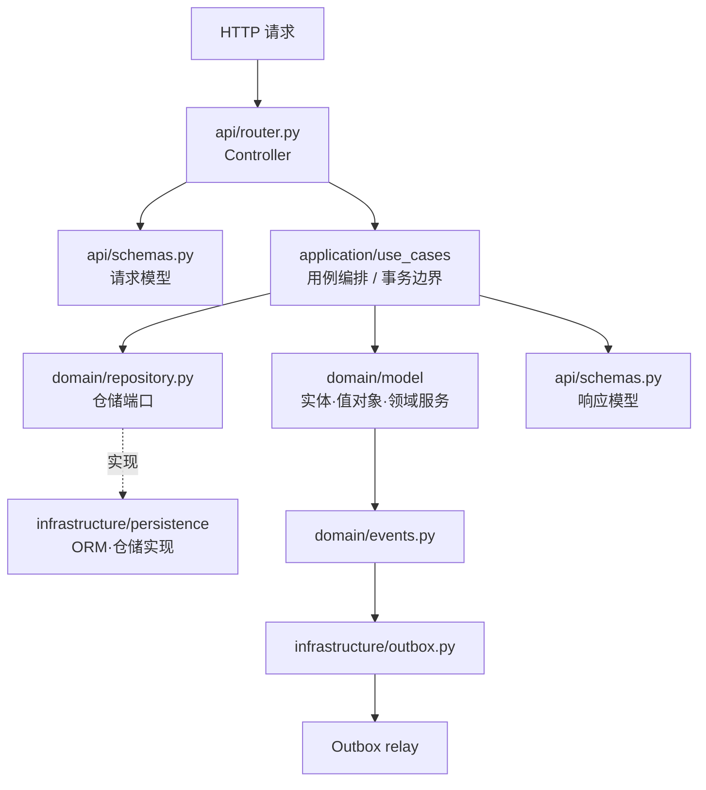
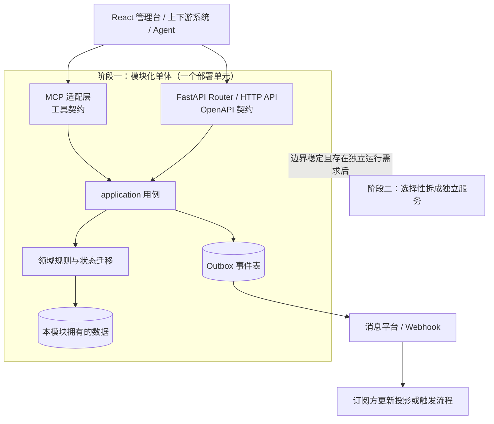
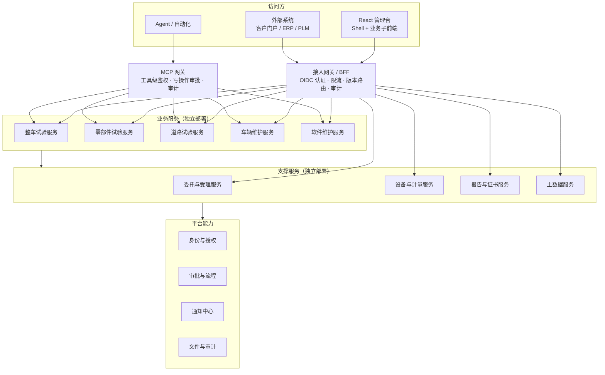
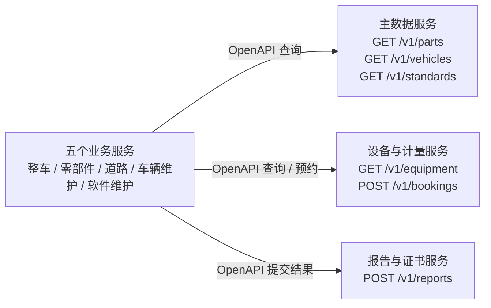
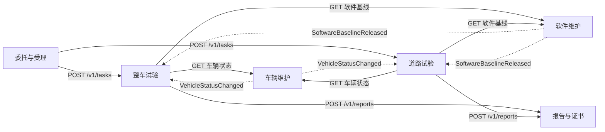
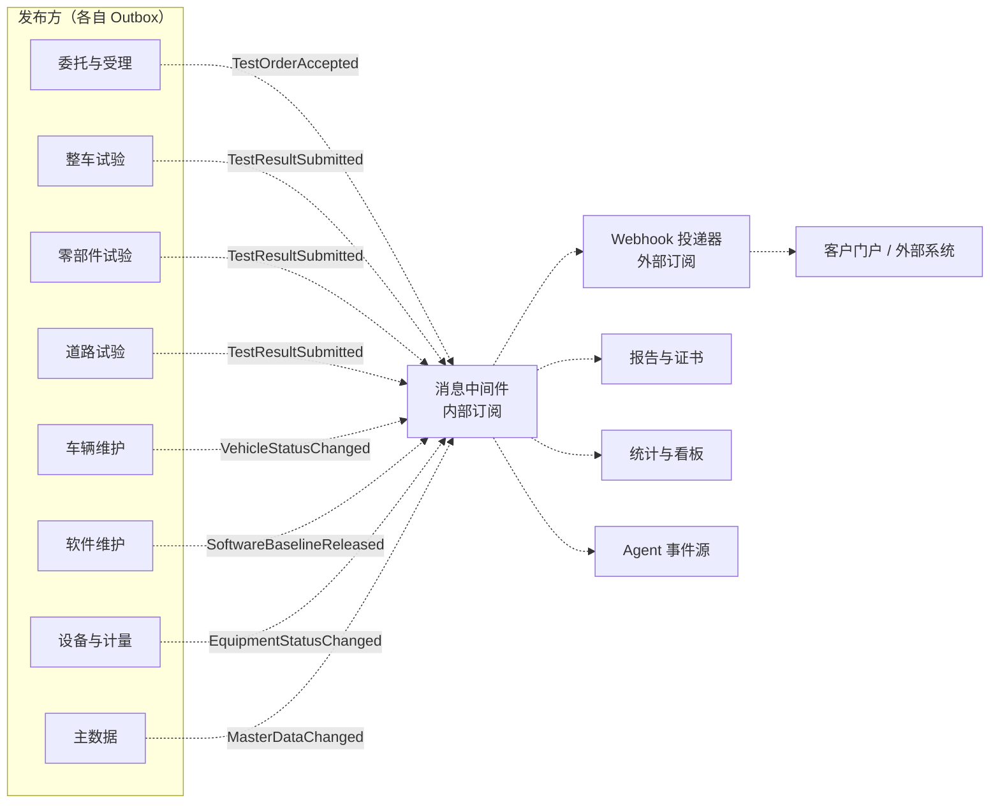
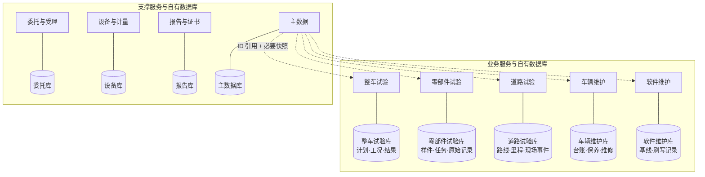
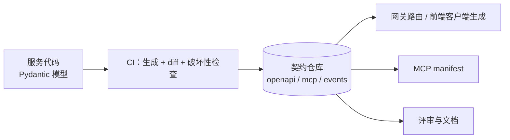
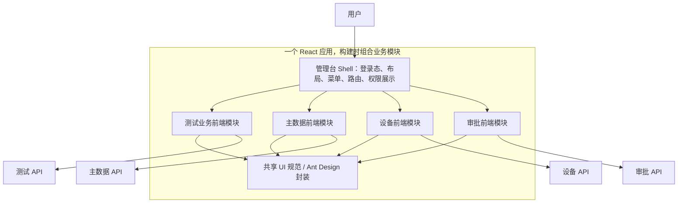

# DDD模块边界与数据协作

## 问题 / 主题

为制造测试业务设计可逐步演进的软件架构：使用 FastAPI + MySQL 建立业务模块，管理主数据与服务间状态同步，划分权限和公共能力，并让不同团队协同交付一个 React + Ant Design 管理台，同时为 Agent 接入 MCP 留出位置。

## 结论

DDD 用于识别业务边界、领域模型和数据责任，不等同于微服务，也不要求一个业务模块对应一个独立部署的服务。MVC 与 DDD 不冲突：MVC 可组织接口适配层，DDD 用于业务建模和模块边界。这种分层落到代码里是什么样子，见下文《项目目录：DDD 分层中的 MVC》。

建议采用渐进路径：

1. 先做模块化单体：一个 FastAPI 应用，按业务能力组织代码；一个 React 管理台，按业务模块组织前端代码。
2. 明确每类业务数据的权威写入方，模块只通过公开的 application 用例或稳定 API 协作，不直接访问其他模块的表和内部模型。
3. 用统一身份认证和服务端业务授权保护用例；共享能力按真实业务职责划界。
4. 服务间同步使用 HTTP API，状态传播使用事件；需要可靠发布时采用 Outbox、幂等消费和对账。
5. 只有独立发布、扩缩容、故障隔离或团队自治需求明确时，才将模块拆为服务；前端也只有在独立发布确有价值时再考虑微前端。
6. OpenAPI/HTTP 作为普通服务调用的明确契约；MCP 作为 Agent 发现和调用能力的适配层，不替代核心业务 API 或事件契约。

## 项目目录：DDD 分层中的 MVC

外层按限界上下文分包，内层按 DDD 分层；MVC 的 Controller、View、Model 各自落在对应层，而不是在整个项目里铺一层 `controllers/`、`models/`。下面是一个 FastAPI 模块化单体的目录示例（只展开 `parts_test`，其余上下文结构相同）：

```text
test-center/
├── app/
│   ├── main.py                         # 组装 FastAPI、注册路由、中间件
│   ├── config.py
│   │
│   ├── contexts/                       # 限界上下文：每个上下文一个包
│   │   ├── parts_test/                 # 零部件试验
│   │   │   ├── domain/                 # 领域层：不依赖任何外层
│   │   │   │   ├── model/
│   │   │   │   │   ├── test_task.py    # 实体、聚合根
│   │   │   │   │   ├── sample.py
│   │   │   │   │   └── value_objects.py
│   │   │   │   ├── service/
│   │   │   │   │   └── scheduling.py   # 领域服务
│   │   │   │   ├── repository.py       # 仓储端口（接口）
│   │   │   │   └── events.py           # 领域事件
│   │   │   ├── application/            # 应用层：用例编排、事务边界
│   │   │   │   ├── use_cases/
│   │   │   │   │   ├── create_task.py
│   │   │   │   │   └── submit_result.py
│   │   │   │   ├── dto.py              # 用例输入/输出
│   │   │   │   └── ports.py            # 外部依赖端口
│   │   │   ├── infrastructure/         # 基础设施层：实现端口
│   │   │   │   ├── persistence/
│   │   │   │   │   ├── models.py       # SQLAlchemy 模型（数据模型）
│   │   │   │   │   ├── repository.py   # 仓储实现
│   │   │   │   │   └── mapper.py       # 领域对象 ↔ ORM 行
│   │   │   │   ├── acl/
│   │   │   │   │   └── legacy_erp.py   # 防腐层适配器
│   │   │   │   └── outbox.py
│   │   │   └── api/                    # 接口层：Controller / View Model
│   │   │       ├── router.py           # Controller
│   │   │       ├── schemas.py          # Pydantic 请求/响应模型
│   │   │       └── dependencies.py     # 鉴权、分页等依赖
│   │   │
│   │   ├── powertrain_test/
│   │   ├── road_test/
│   │   ├── vehicle_maintenance/
│   │   ├── software_maintenance/
│   │   ├── test_order/
│   │   ├── equipment/
│   │   ├── report/
│   │   └── master_data/
│   │
│   ├── shared_kernel/                  # 值对象、单位量纲、错误模型、事件信封
│   │   ├── value_objects.py
│   │   ├── errors.py
│   │   └── events.py
│   │
│   ├── platform/                       # 通用域：IAM、审批、通知、文件、审计
│   │   ├── iam/
│   │   ├── workflow/
│   │   ├── notify/
│   │   ├── files/
│   │   └── audit/
│   │
│   └── bootstrap/                      # 依赖注入、订阅注册、启动装配
│       ├── container.py
│       └── subscriptions.py
│
├── contracts/                          # 契约制品
│   ├── openapi/
│   ├── mcp/
│   └── events/
│
├── migrations/                         # 迁移按上下文分目录
│   ├── parts_test/
│   └── ...
│
├── tests/
│   ├── unit/                           # 领域层，不依赖数据库
│   ├── integration/                    # 仓储、ACL、Outbox
│   └── contract/                       # OpenAPI / 事件 / MCP schema 校验
│
├── pyproject.toml
└── README.md
```

MVC 与目录的对应关系：

| MVC 角色 | 目录位置 | 职责 | 不应该做什么 |
|---|---|---|---|
| Model（领域模型） | `contexts/*/domain/model/` | 实体、值对象、业务规则 | 不依赖 FastAPI、SQLAlchemy |
| Model（持久化模型） | `contexts/*/infrastructure/persistence/models.py` | 表结构映射 | 不承载业务规则 |
| Model（视图模型） | `contexts/*/api/schemas.py` | 请求/响应结构、字段校验 | 不写业务规则 |
| View | `api/schemas.py` + `response_model` | JSON 序列化、字段裁剪 | 不做权限和业务判断 |
| Controller | `contexts/*/api/router.py` | 参数解析、鉴权入口、调用用例、异常映射 | 不写业务规则 |
| Service（MVC 常见） | `contexts/*/application/use_cases/` | 用例编排、事务边界 | 不直接拼 SQL |
| DAO / Repository | `domain/repository.py`（接口）+ `infrastructure/persistence/repository.py`（实现） | 接口与实现分离 | 不在接口里暴露 ORM 对象 |

关键点：**MVC 的“Model”是一个被重载的词**。在 MVC 里它常指数据模型或视图模型；在 DDD 里它拆成三个东西——领域模型（业务规则）、持久化模型（表结构）、视图模型（API 结构）。混用这三者，就会得到“ORM 实体直接当 API 响应、业务规则写在 Pydantic schema 里”的典型烂结构。

一次请求的调用链：



依赖方向：

- `api → application → domain`；`infrastructure → domain`（实现端口）；`domain` 不依赖任何外层。
- `api` 不直接 import `infrastructure`；具体实现在 `bootstrap/container.py` 装配。
- 上下文之间只通过 application 用例或公开接口调用，不 import 对方的 `domain/`。
- `shared_kernel` 保持最小；`utils/` 不要变成跨上下文的万能层。

为什么顶层按上下文分包，而不是按 `models/`、`controllers/` 分包：

- 按层分包会让跨上下文 import 变得很容易，边界很快模糊；按上下文分包，谁拥有什么数据一眼可见。
- 将来把某个上下文拆成独立服务时，主要是搬一个目录、把进程内调用换成 HTTP/事件，业务代码不动。
- 每个上下文可以有自己的测试、迁移和代码所有者，和 [[测试业务DDD上下文划分]] 的边界一一对应。

## 架构关系图

### 后端业务边界与部署演进

以下以测试中心为例，业务线包括整车试验、零部件试验、道路试验、车辆维护、软件维护。阶段一和阶段二共用同一套限界上下文，区别只在部署单元和通信方式：阶段一在进程内调用，阶段二把同一套 application 用例暴露成 HTTP/OpenAPI 和事件。

#### 阶段一：模块化单体



要点：

- 一个 FastAPI 应用，按上下文分包；每个包内部再分 `domain / application / infrastructure / api`。
- HTTP 和 MCP 只是入口，共用同一个 application 用例，不各写一套业务规则。
- Outbox 表在同一个数据库，relay 可以在进程内，也可以独立进程。
- 此时不要让模块之间走 HTTP 自调用，直接调公开的 application 接口。

#### 阶段二：独立服务

##### 2.1 部署拓扑与访问路径



说明：

- 五条业务线各自部署、各自数据库；支撑服务被多条业务线复用，但不拥有业务执行逻辑。
- 网关只做横切（认证、限流、版本路由、审计），业务聚合放 BFF；MCP 走独立网关，因为工具级鉴权和写操作审批的粒度与 REST 不同。
- 平台能力可以是共享服务，也可以是库，取决于是否多语言、是否要独立运维。

##### 2.2 同步协作：HTTP + OpenAPI

原则：需要立即结果的查询和命令走 HTTP；每个服务发布 OpenAPI 制品，消费方 pin 主版本，网关按主版本路由。

**业务服务 → 支撑服务**（查询主数据、设备预约）：



**业务服务之间**（车辆维护、软件维护与试验线）：



实线是同步 HTTP，虚线是事件；两类线不要混用成同一种“通知”。关键接口：

| 调用方 | 被调方 | 方法与路径 | 用途 |
|---|---|---|---|
| 业务服务 | 主数据 | `GET /v1/parts/{part_no}`、`GET /v1/vehicles/{vin}`、`GET /v1/standards/{code}` | 查询主数据 |
| 业务服务 | 设备与计量 | `GET /v1/equipment`、`POST /v1/bookings` | 查设备能力与预约 |
| 委托与受理 | 整车/零部件/道路 | `POST /v1/tasks` | 下发试验任务 |
| 整车/道路 | 车辆维护 | `GET /v1/vehicles/{vin}/status` | 查车辆可用性与维护状态 |
| 整车/道路 | 软件维护 | `GET /v1/software/baselines?ecu=...` | 查 ECU 软件基线 |
| 业务服务 | 报告与证书 | `POST /v1/reports` | 提交结果、生成报告 |

##### 2.3 异步协作：Outbox + 事件 + 订阅

每个发布方有自己的 outbox 表；内部消费者走消息中间件，外部订阅方走 Webhook。事件信封、重试、死信和幂等的细节见 [[API交互面与契约治理]]。



主要事件：

| 事件 | 发布方 | 主要订阅方 | 用途 |
|---|---|---|---|
| `TestOrderAccepted` | 委托与受理 | 整车/零部件/道路 | 创建试验任务 |
| `TestResultSubmitted` | 整车/零部件/道路 | 报告与证书、看板 | 生成报告 |
| `EquipmentStatusChanged` | 设备与计量 | 三条试验线 | 校准、维修、停用感知 |
| `VehicleStatusChanged` | 车辆维护 | 整车/道路 | 车辆可用性变化 |
| `MaintenanceCompleted` | 车辆维护 | 整车/道路、看板 | 维护完成 |
| `SoftwareBaselineReleased` | 软件维护 | 整车/道路 | 软件基线发布 |
| `FlashCompleted` | 软件维护 | 整车/道路 | 刷写完成 |
| `MasterDataChanged` | 主数据 | 全部服务 | 主数据变更 |
| `ReportApproved` | 报告与证书 | 委托与受理、客户门户 | 报告可交付 |

规则：事件只表达已发生的事实，不当远程命令；消费方按 `event_id` 幂等；跨聚合不保证顺序；关键状态用推送 + 查询对账，不假设事件永不丢。

##### 2.4 数据所有权与部署单元



数据归属：

| 服务    | 拥有的数据          | 明确不拥有       |
| ----- | -------------- | ----------- |
| 整车试验  | 试验计划、工况、整车试验结果 | 车辆台账、零件主数据  |
| 零部件试验 | 样件、试验任务、原始记录   | 零件主数据、设备台账  |
| 道路试验  | 路线、里程、现场事件     | 车辆台账、驾驶员资质  |
| 车辆维护  | 车辆台账、保养计划、维修工单 | 试验结果        |
| 软件维护  | ECU 软件基线、刷写记录  | 车型配置、试验结果   |
| 委托与受理 | 委托单、受理状态       | 试验执行细节      |
| 设备与计量 | 设备台账、校准、预约     | 试验结果        |
| 报告与证书 | 报告、证书          | 原始试验数据（只引用） |
| 主数据   | 零件、车型、标准、组织、客户 | 业务记录        |
|       |                |             |

三条硬规则：

1. 一个数据对象只有一个权威写入方；其他服务通过命令或 API 发起变更。
2. 其他服务只存 ID 引用和必要快照，保证历史可解释；不跨库 join。
3. 物理数据库可以同实例，但逻辑 schema、迁移责任和访问账号必须分开；拆服务时再迁到独立库。

##### 2.5 契约与通信方式总览

| 方式      | 图上线型  | 契约                   | 适用       | 失败处理            |
| ------- | ----- | -------------------- | -------- | --------------- |
| 同步 HTTP | 实线    | OpenAPI 制品           | 查询、命令    | 超时、重试、熔断、降级     |
| 异步事件    | 虚线    | 事件 envelope + schema | 状态传播     | Outbox、幂等、死信、重放 |
| Webhook | 点线    | 订阅契约 + HMAC 签名       | 外部通知     | 重试、死信、自动停用      |
| MCP     | 网关到工具 | tool manifest        | Agent 调用 | `isError`、审批、审计 |



讲解时建议按“访问路径 → 同步调用 → 异步事件 → 数据归属 → 契约”的顺序展开，每张图只回答一个问题，不要在一张图里同时讲部署、调用和数据。

### 多团队协同建设统一管理台



## 论证 / 对比

### DDD、MVC、微服务与 Spring Cloud

- MVC 主要组织接口或展示层；DDD 用于业务模型、限界上下文和数据责任；微服务描述独立部署和运行边界；Spring Cloud 是 Java 微服务治理工具生态。
- DDD 模块可以先存在同一个进程和部署单元中。Java 也能做模块化单体，Python/FastAPI 也能做独立微服务。
- 模块化单体中的业务模块通过本地 application 接口协作；拆成服务后，调用适配器改为 HTTP/RPC 或消息，不应让内部业务逻辑依赖 Controller。
- 服务拆分会引入网络延迟、部分失败、独立数据存储、兼容性和可观测性成本，不能只按组织名称或目录结构拆分。

### 数据资产与主数据

- 每类主数据应有明确的权威写入方。只有数据所有者负责创建、修改、停用等业务规则。
- 其他模块变更主数据时，通过数据所有者公开的命令用例或 API 发起；不得直接写入对方表。
- 其他模块可以保存自己负责的业务记录，并通过 ID 引用主数据。为保证历史可解释性，可保存当时的配置版本或必要字段快照。
- 模块化单体阶段可使用同一 MySQL 实例，但需明确表所有者、迁移责任和访问边界。物理数据库可共享，逻辑数据所有权不可含糊。
- 独立服务后，服务拥有自己的数据访问边界；避免多个服务直接读写同一组表。跨服务数据副本通常最终一致。

### 调用、事件与外部系统

- 外部 HTTP 请求进入 Router/Controller，再转到 application 用例；模块内协作直接调用公开的 application 接口，不通过 HTTP 自调用。
- 同步 HTTP API 适合需要立即结果的查询或命令。OpenAPI 描述路径、参数、响应和错误契约，可用于文档与客户端生成。
- 事件表达已发生的事实，如 `TaskCreated`、`TestReportSubmitted`。它适合状态传播和解耦订阅方，不应被当成无约束的远程命令通道。
- Outbox 将业务数据和待发送事件写入同一数据库事务，后台投递程序负责重试。消费者需要按事件 ID 去重并幂等处理；另需监控、死信/失败处置和定期对账。表结构、relay 与投递通道（中间件 vs Webhook）的细节见 [[API交互面与契约治理]]。
- 若上下游由其他团队维护，先确认 webhook、消息平台、CDC/变更流、增量查询或批量文件能力。只有查询 API 时，需轮询和对账；主动通知必须由对方提供推送能力或共同建设消息通道。
- 若双方都能修改同一业务事实，必须先定义权威来源、冲突处理和审批规则；双向通知本身不能解决并发覆盖。

### SSO、业务授权和共享能力

- 优先接入企业身份提供方（IdP），使用 OIDC/OAuth 2.0 等标准完成统一登录和身份声明；不轻易自建 IdP。
- 身份认证回答“用户是谁”；业务授权回答“此用户能否对某个业务对象执行某个用例”。授权应由业务服务端执行，不能只依赖前端隐藏菜单或按钮。
- 可统一身份、角色/权限管理或策略配置，但各业务服务仍需在接口或 application 用例入口落实授权，并做资源级/数据范围校验。
- 审批若拥有通用流程实例、节点、委托和审批历史，可作为独立业务模块；各业务仍拥有自己的审批对象和状态规则。审批完成后以事件通知业务所有者更新状态。
- 通知发送、日志、文件、鉴权基础设施等可作为平台能力；“因何业务事件通知谁”仍由业务模块决定。
- 避免建立包揽所有跨域规则的“公共服务”或“万能权限服务”；用明确上下文和接口责任代替模糊公共模块。

### React 管理台与团队协作

- 后端微服务不要求前端同步拆成微前端。初期建议一个 React + Ant Design 管理台，构建时组合按业务域划分的前端模块。
- 管理台 Shell 由平台/前端基础团队维护：路由注册、导航、布局、登录态、权限展示、错误处理、设计规范和构建发布。
- 业务团队拥有对应页面、表单、列表、模块状态和 API 客户端；通过约定的路由入口接入，避免直接依赖其他业务模块的内部组件或状态。
- 共享 UI 库提供视觉和交互基础，不承载跨业务规则。每个状态由其业务模块拥有；仅把真正需要协调的状态提升到共同父级。
- 前后端契约可由 OpenAPI 维护并生成/校验 TypeScript 类型和客户端。前端权限声明只用于体验，后端必须再次鉴权。
- 多团队可用单仓库工作区、代码所有者、模块级 CI 和契约评审并行开发，再由一个管理台构建发布。
- 当不同团队必须独立发布前端、运行时组合且有稳定模块公共接口时，再采用 Module Federation 或 single-spa 等微前端方案；它会增加依赖共享、版本兼容、本地开发、跨模块状态和监控成本。
- 页面需频繁聚合多个服务、或浏览器侧服务发现/令牌处理复杂时，可增加面向该管理台的 BFF。BFF 负责视图聚合，不取代业务服务，不绕过业务授权。

### MCP 与服务接口

- MCP 适合 Agent 发现并调用带语义描述的工具、资源和提示；普通服务间确定性调用通常仍用 HTTP API/OpenAPI，异步状态传播用事件/消息。
- MCP 工具描述可以减少 Agent 选择工具和理解参数的成本，但不能自动替代业务契约、状态规则、幂等、认证授权、错误语义和集成测试。
- 可将 MCP 做成适配层，复用同一 application 用例；Agent 经 MCP 调用，普通服务经 HTTP API 调用，核心业务逻辑不绑定 MCP 生命周期和协议版本。
- MCP 规范持续演进，需要明确协议版本、客户端兼容和安全边界，因此不建议把它作为所有微服务的唯一通用接口。

## 方案汇报建议结构

1. **业务背景与目标**：多个测试业务线共享主数据和设备能力，同时存在各自闭环流程及外部上下游。
2. **设计原则**：业务边界优先、数据权威明确、模块内低成本协作、跨服务显式契约、逐步演进。
3. **目标架构**：FastAPI 模块化单体 + MySQL 逻辑数据所有权 + React 模块化管理台；外部系统通过 API/事件集成。
4. **数据与状态同步**：主数据责任矩阵、HTTP/事件选择、Outbox、幂等重试、失败补偿和对账。
5. **安全与通用能力**：企业 SSO、服务端业务授权、资源范围；审批作为业务能力、通知等作为平台能力。
6. **团队协作**：业务模块负责人、管理台 Shell 负责人、API/事件契约评审、模块文档和 Agent 上下文约定。
7. **演进路线与触发条件**：先模块化单体和整体前端发布；当独立部署/伸缩/隔离或团队自治价值超过分布式成本时，选择性拆服务/微前端。
8. **待决策事项**：零件/产品单位/设备等权威系统；上游通知能力；权限模型；事件基础设施；部署、SLO 与灾备要求。

## 引用的页面

- [[测试业务DDD上下文划分]]：本文方法论的落地案例，含四条试验业务线的上下文地图、场景时序图与主数据提取判据。
- [[API交互面与契约治理]]：服务拆开后的接口面设计，含 OpenAPI/MCP 报文、版本兼容与双向读写规则。

## 外部参考

- [FastAPI：较大型应用的多文件组织](https://fastapi.tiangolo.com/tutorial/bigger-applications/)
- [OpenAPI Specification](https://spec.openapis.org/oas/v3.1.2.html)
- [OpenID Connect Core](https://openid.net/specs/openid-connect-core-1_0-final.html)
- [Azure：微服务数据设计](https://learn.microsoft.com/azure/architecture/microservices/design/data-considerations)
- [AWS：Transactional Outbox](https://docs.aws.amazon.com/prescriptive-guidance/latest/cloud-design-patterns/transactional-outbox.html)
- [React：组件间共享状态](https://react.dev/learn/sharing-state-between-components)
- [single-spa：微前端推荐设置](https://single-spa.js.org/docs/recommended-setup/)
- [MCP：2026-07-28 规范更新说明](https://blog.modelcontextprotocol.io/posts/2026-07-28/)

## 尚存的缺口 / 待研究

- 需结合具体系统确认零件编号、产品单位配置、设备能力和测试报告分别由哪个上下文权威维护。
- 需与各上下游团队确认事件推送、增量查询、重试及对账能力和责任边界。
- 需明确企业 IdP、角色/资源权限模型、授权管理责任和服务间身份方案。
- 需按负载、部署与运维能力决定是否引入消息平台、BFF，以及服务或微前端拆分时机。
