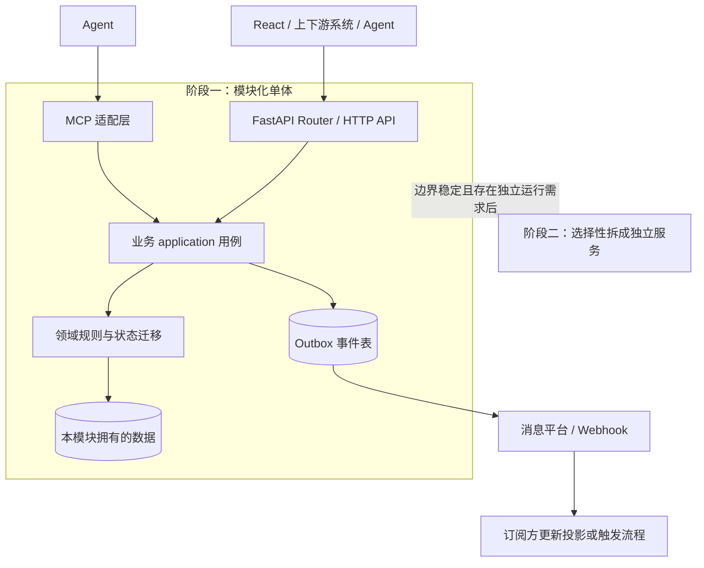
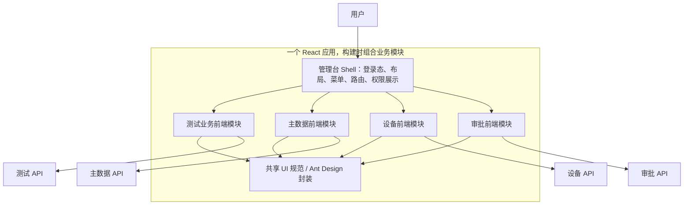

# DDD模块边界与数据协作

## 问题 / 主题

为制造测试业务设计可逐步演进的软件架构：使用 FastAPI + MySQL 建立业务模块，管理主数据与服务间状态同步，划分权限和公共能力，并让不同团队协同交付一个 React + Ant Design 管理台，同时为 Agent 接入 MCP 留出位置。

## 结论

DDD 用于识别业务边界、领域模型和数据责任，不等同于微服务，也不要求一个业务模块对应一个独立部署的服务。MVC 与 DDD 不冲突：MVC 可组织接口适配层，DDD 用于业务建模和模块边界。

建议采用渐进路径：

1. 先做模块化单体：一个 FastAPI 应用，按业务能力组织代码；一个 React 管理台，按业务模块组织前端代码。
2. 明确每类业务数据的权威写入方，模块只通过公开的 application 用例或稳定 API 协作，不直接访问其他模块的表和内部模型。
3. 用统一身份认证和服务端业务授权保护用例；共享能力按真实业务职责划界。
4. 服务间同步使用 HTTP API，状态传播使用事件；需要可靠发布时采用 Outbox、幂等消费和对账。
5. 只有独立发布、扩缩容、故障隔离或团队自治需求明确时，才将模块拆为服务；前端也只有在独立发布确有价值时再考虑微前端。
6. OpenAPI/HTTP 作为普通服务调用的明确契约；MCP 作为 Agent 发现和调用能力的适配层，不替代核心业务 API 或事件契约。

## 架构关系图

### 后端业务边界与部署演进

### 多团队协同建设统一管理台

## 论证 / 对比

### DDD、MVC、微服务与 Spring Cloud

- MVC 主要组织接口或展示层；DDD 用于业务模型、限界上下文和数据责任；微服务描述独立部署和运行边界；Spring Cloud 是 Java 微服务治理工具生态。
- DDD 模块可以先存在同一个进程和部署单元中。Java 也能做模块化单体，Python/FastAPI 也能做独立微服务。
- 模块化单体中的业务模块通过本地 application 接口协作；拆成服务后，调用适配器改为 HTTP/RPC 或消息，不应让内部业务逻辑依赖 Controller。
- 服务拆分会引入网络延迟、部分失败、独立数据存储、兼容性和可观测性成本，不能只按组织名称或目录结构拆分。

### 数据资产与主数据

- 每类主数据应有明确的权威写入方。只有数据所有者负责创建、修改、停用等业务规则。
- 其他模块变更主数据时，通过数据所有者公开的命令用例或 API 发起；不得直接写入对方表。
- 其他模块可以保存自己负责的业务记录，并通过 ID 引用主数据。为保证历史可解释性，可保存当时的配置版本或必要字段快照。
- 模块化单体阶段可使用同一 MySQL 实例，但需明确表所有者、迁移责任和访问边界。物理数据库可共享，逻辑数据所有权不可含糊。
- 独立服务后，服务拥有自己的数据访问边界；避免多个服务直接读写同一组表。跨服务数据副本通常最终一致。

### 调用、事件与外部系统

- 外部 HTTP 请求进入 Router/Controller，再转到 application 用例；模块内协作直接调用公开的 application 接口，不通过 HTTP 自调用。
- 同步 HTTP API 适合需要立即结果的查询或命令。OpenAPI 描述路径、参数、响应和错误契约，可用于文档与客户端生成。
- 事件表达已发生的事实，如 `TaskCreated`、`TestReportSubmitted`。它适合状态传播和解耦订阅方，不应被当成无约束的远程命令通道。
- Outbox 将业务数据和待发送事件写入同一数据库事务，后台投递程序负责重试。消费者需要按事件 ID 去重并幂等处理；另需监控、死信/失败处置和定期对账。
- 若上下游由其他团队维护，先确认 webhook、消息平台、CDC/变更流、增量查询或批量文件能力。只有查询 API 时，需轮询和对账；主动通知必须由对方提供推送能力或共同建设消息通道。
- 若双方都能修改同一业务事实，必须先定义权威来源、冲突处理和审批规则；双向通知本身不能解决并发覆盖。

### SSO、业务授权和共享能力

- 优先接入企业身份提供方（IdP），使用 OIDC/OAuth 2.0 等标准完成统一登录和身份声明；不轻易自建 IdP。
- 身份认证回答“用户是谁”；业务授权回答“此用户能否对某个业务对象执行某个用例”。授权应由业务服务端执行，不能只依赖前端隐藏菜单或按钮。
- 可统一身份、角色/权限管理或策略配置，但各业务服务仍需在接口或 application 用例入口落实授权，并做资源级/数据范围校验。
- 审批若拥有通用流程实例、节点、委托和审批历史，可作为独立业务模块；各业务仍拥有自己的审批对象和状态规则。审批完成后以事件通知业务所有者更新状态。
- 通知发送、日志、文件、鉴权基础设施等可作为平台能力；“因何业务事件通知谁”仍由业务模块决定。
- 避免建立包揽所有跨域规则的“公共服务”或“万能权限服务”；用明确上下文和接口责任代替模糊公共模块。

### React 管理台与团队协作

- 后端微服务不要求前端同步拆成微前端。初期建议一个 React + Ant Design 管理台，构建时组合按业务域划分的前端模块。
- 管理台 Shell 由平台/前端基础团队维护：路由注册、导航、布局、登录态、权限展示、错误处理、设计规范和构建发布。
- 业务团队拥有对应页面、表单、列表、模块状态和 API 客户端；通过约定的路由入口接入，避免直接依赖其他业务模块的内部组件或状态。
- 共享 UI 库提供视觉和交互基础，不承载跨业务规则。每个状态由其业务模块拥有；仅把真正需要协调的状态提升到共同父级。
- 前后端契约可由 OpenAPI 维护并生成/校验 TypeScript 类型和客户端。前端权限声明只用于体验，后端必须再次鉴权。
- 多团队可用单仓库工作区、代码所有者、模块级 CI 和契约评审并行开发，再由一个管理台构建发布。
- 当不同团队必须独立发布前端、运行时组合且有稳定模块公共接口时，再采用 Module Federation 或 single-spa 等微前端方案；它会增加依赖共享、版本兼容、本地开发、跨模块状态和监控成本。
- 页面需频繁聚合多个服务、或浏览器侧服务发现/令牌处理复杂时，可增加面向该管理台的 BFF。BFF 负责视图聚合，不取代业务服务，不绕过业务授权。

### MCP 与服务接口

- MCP 适合 Agent 发现并调用带语义描述的工具、资源和提示；普通服务间确定性调用通常仍用 HTTP API/OpenAPI，异步状态传播用事件/消息。
- MCP 工具描述可以减少 Agent 选择工具和理解参数的成本，但不能自动替代业务契约、状态规则、幂等、认证授权、错误语义和集成测试。
- 可将 MCP 做成适配层，复用同一 application 用例；Agent 经 MCP 调用，普通服务经 HTTP API 调用，核心业务逻辑不绑定 MCP 生命周期和协议版本。
- MCP 规范持续演进，需要明确协议版本、客户端兼容和安全边界，因此不建议把它作为所有微服务的唯一通用接口。

## 方案汇报建议结构

1. **业务背景与目标**：多个测试业务线共享主数据和设备能力，同时存在各自闭环流程及外部上下游。
2. **设计原则**：业务边界优先、数据权威明确、模块内低成本协作、跨服务显式契约、逐步演进。
3. **目标架构**：FastAPI 模块化单体 + MySQL 逻辑数据所有权 + React 模块化管理台；外部系统通过 API/事件集成。
4. **数据与状态同步**：主数据责任矩阵、HTTP/事件选择、Outbox、幂等重试、失败补偿和对账。
5. **安全与通用能力**：企业 SSO、服务端业务授权、资源范围；审批作为业务能力、通知等作为平台能力。
6. **团队协作**：业务模块负责人、管理台 Shell 负责人、API/事件契约评审、模块文档和 Agent 上下文约定。
7. **演进路线与触发条件**：先模块化单体和整体前端发布；当独立部署/伸缩/隔离或团队自治价值超过分布式成本时，选择性拆服务/微前端。
8. **待决策事项**：零件/产品单位/设备等权威系统；上游通知能力；权限模型；事件基础设施；部署、SLO 与灾备要求。

## 引用的页面

- 暂无

## 外部参考

- [FastAPI：较大型应用的多文件组织](https://fastapi.tiangolo.com/tutorial/bigger-applications/)
- [OpenAPI Specification](https://spec.openapis.org/oas/v3.1.2.html)
- [OpenID Connect Core](https://openid.net/specs/openid-connect-core-1_0-final.html)
- [Azure：微服务数据设计](https://learn.microsoft.com/azure/architecture/microservices/design/data-considerations)
- [AWS：Transactional Outbox](https://docs.aws.amazon.com/prescriptive-guidance/latest/cloud-design-patterns/transactional-outbox.html)
- [React：组件间共享状态](https://react.dev/learn/sharing-state-between-components)
- [single-spa：微前端推荐设置](https://single-spa.js.org/docs/recommended-setup/)
- [MCP：2026-07-28 规范更新说明](https://blog.modelcontextprotocol.io/posts/2026-07-28/)

## 尚存的缺口 / 待研究

- 需结合具体系统确认零件编号、产品单位配置、设备能力和测试报告分别由哪个上下文权威维护。
- 需与各上下游团队确认事件推送、增量查询、重试及对账能力和责任边界。
- 需明确企业 IdP、角色/资源权限模型、授权管理责任和服务间身份方案。
- 需按负载、部署与运维能力决定是否引入消息平台、BFF，以及服务或微前端拆分时机。
