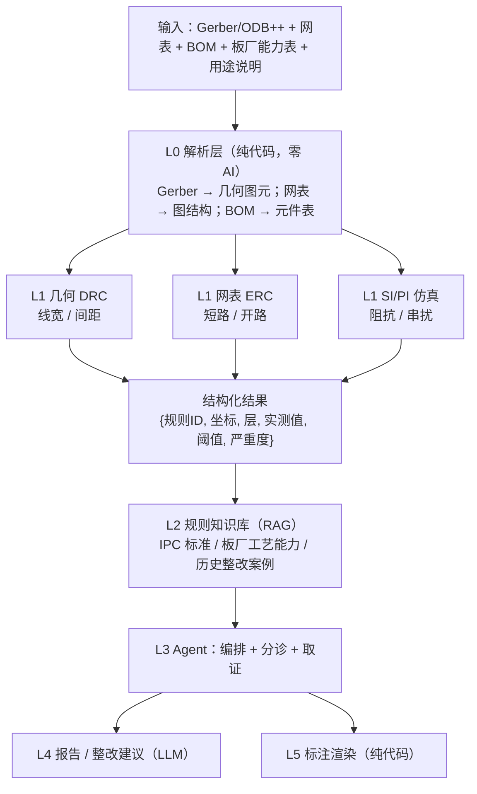

# PCB检查的Agent架构

> PCB 硬件线路检查的正确答案不是“AI 看板子”，而是“确定性引擎做检查、Agent 做调度和分诊、LLM 做解释和表达”。

## 问题 / 主题

开发一块 PCB 后，要对硬件线路做检查，把需要整改的点标记在板子上并生成检测报告和整改建议。这是 agent 在后端完成的工作，还是用 LLM 做分析？后台 AI 的设计方案是什么？

## 结论

先纠正一个危险前提：“假设 AI 能够分析这个板子”。真实架构里没有“AI 看板子”这回事——LLM 既不能可靠地读 Gerber 坐标，也不该被信任去判断 0.08mm 和 0.1mm 哪个大。

正确的分工是：

> **AI 决定“怎么检查这块板子”，然后解释“检查结果意味着什么”。真正的检查由几何算法、图论、仿真器完成。**

分层职责：

- **L1 做分析（算法）**
- **L3 做调度（agent）**
- **L4 做解释（LLM）**

Agent 的职责是“决定检查什么、怎么取证、怎么分诊”——它不产出技术结论，它组织结论。

## 先确认输入

“硬件线路检查”有三种完全不同的输入：

| 输入 | 阶段 | 技术栈 |
|---|---|---|
| Gerber / ODB++ / 网表 / BOM（设计文件） | 设计阶段 | 几何计算 + 图论 + 场仿真 |
| X-ray / AOI 图像（成品板） | 制造后 | CV（CNN/YOLO），不是 LLM |
| 实物照片（返修） | 售后 | CV + 人工 |

本文按第一种（设计文件）展开。

## 分层架构



每一层谁干、为什么：

| 层 | 谁干 | 为什么必须是它 |
|---|---|---|
| L0 解析 | 传统代码 | Gerber 是二进制/文本格式，解析是确定的 |
| L1 检查 | 几何算法 / 图论 / 仿真器 | 见下节，这层绝不能交给 LLM |
| L2 规则选择 | LLM + 检索 | 规则随板厂、标准、板型变化，硬编码维护不动 |
| L3 编排与分诊 | Agent | 路径不可枚举 + 有反馈，唯一符合 agent 定义的地方 |
| L4 表达 | LLM | 自然语言是它的主场 |
| L5 标注 | 传统代码 | 坐标已经算好了，渲染不需要智力 |

## 为什么 L1 绝不能交给 LLM

| 理由 | 后果 |
|---|---|
| 幻觉 | 会“看出”一条不存在的短路，也会漏掉一条真实的开路 |
| 不可复现 | 同一块板跑两次结果不同，客户和产线都无法接受 |
| 不可辩护 | 客户问“为什么这里有问题”，必须能回答“间距 0.08mm < 要求 0.10mm”；“模型觉得”没法交付 |
| 成本 | 高密度板几万个图元，逐元素推理导致 token 爆炸且精度更差 |
| 数值不可靠 | LLM 对精确坐标和数值比较天生不擅长 |

一句话原则，和 [[Agent适用性判据]] 完全同构：

> **凡是确定性算法能算出来的，绝不用 LLM。LLM 只处理算法算不出来的模糊部分。**

PCB 领域这条尤其硬，因为错误成本从几千块打样费到几十万量产报废。

## Agent 的增量在哪

如果没有增量，产品就只是“又一个 CAM 检查工具”（市面上已有 Valor、CAM350、各家 EDA 自带的 DFM）。真正的机会在四块：

1. **规则选择的自动化**。传统工具要工程师手工配几百条规则和参数，配错漏检，配严淹没在误报里。规则依赖板厂能力：A 厂最小线宽 0.1mm，B 厂能到 0.075mm。Agent 读板型、层数、用途、目标板厂能力表，自动选一套合理规则集，并说明“为什么选这些”。
2. **误报分诊（ROI 最高）**。传统工具报 5000 条，工程师一条条看到吐，最后干脆不看——这是行业里真实存在的失效模式。Agent 做聚类（同一根网络导致的 12 条报错合成 1 条根因）、分级（必须改 / 工艺上能过但建议优化）、丢弃噪声（丝印压焊盘这类）。5000 条 → 23 个真问题，这是最能被客户感知的价值。
3. **跨域关联取证**。一个 DRC 警告单独看是“轻微”，但它可能掩盖一个功能性风险。
4. **从“报错”到“整改方案”**。传统工具说“间距不足”；Agent 结合工艺能力表和案例库，能说“两方案：① 线往左移 0.05mm（空间够）；② 改用 6mil 工艺，该厂支持但单价 +8%。推荐 ①”。这是从“检查工具”变成“能给出可执行方案的工具”的分水岭。

## 一条 ReAct 轨迹

```text
输入：6 层板 / 电源管理模块 / 目标板厂 A（最小线宽 0.1mm、最小间距 0.1mm）

Thought: 先跑几何 DRC，用板厂 A 的规则集。电源模块要额外关注载流能力。
Action:  run_drc(ruleset=A_dfm)
Obs:     47 条违规：line_width ×12（全在区域 R3）、spacing ×31、silkscreen ×4

Thought: 12 条线宽问题全挤在 R3，像是同一根网络。先确认是不是电源线——
         如果是，严重度完全不同。
Action:  query_netlist(region=R3)
Obs:     该区域为 VCC_12V 网络；设计电流 2A；铜厚 1oz

Thought: 这是功能性风险，不是“轻微 DFM 警告”。算一下载流够不够。
Action:  run_current_capacity(net=VCC_12V, current=2A)
Obs:     实测线宽 0.15mm，2A 需要 ≥0.30mm → 不足

Thought: 找到根因了。12 条警告其实是 1 个 P1 问题。
         查一下历史案例有没有类似整改。
Action:  lookup_cases("VCC 线宽不足 12V")
Obs:     3 条历史案例，其中 2 条通过加宽至 0.35mm 解决，1 条改为铺铜

Thought: 有足够信息了。R3 区域空间够，建议加宽。生成标注和报告。
Action:  annotate(bbox=R3, layer=L2, severity=P1, reason="VCC_12V 载流不足")
Action:  write_report(...)
```

关键一跳：它把一个“DFM 轻微警告”升级成了“P1 功能风险”。静态工具永远不会做这个动作，因为它不知道那根线是电源线，也不知道设计电流是 2A。**Agent 的价值不是算得更准，是知道该多问一句。**

## 标注怎么落地

LLM 输出结构化 JSON，不输出图片、不输出文字描述：

```json
[
  {
    "id": "ISSUE-001",
    "bbox": {"x": 42.31, "y": 18.77, "w": 0.15, "h": 3.20},
    "layer": "L2",
    "severity": "P1",
    "rule": "current_capacity",
    "measured": 0.15,
    "required": 0.30,
    "fix": "加宽至 0.35mm"
  }
]
```

前端用 Canvas / SVG 叠加到板图渲染。三条铁律：

1. **标注坐标必须来自 L1 引擎，不能来自 LLM。** LLM 说“大约在中间偏左”是灾难。
2. **LLM 只输出 JSON，不输出图片。** 渲染是程序的事。
3. **每个标注必须带 `measured` 和 `required`。** 这是“可辩护”的唯一形式。

## 形态

| 形态 | 判断 |
|---|---|
| 网页对话框 | ❌ 输入是几十上百 MB 的 Gerber，贴不进去；只能当“提问入口”（“帮我重点看看电源部分”） |
| 桌面 MCP | ⚠️ 合理。工程师的 Gerber 和 CAD 在本机，MCP 能连本地文件 + 本地 CAM 工具；适合个人/小团队 |
| 后台服务 + 查看器 | ✅ 主体形态。重计算在服务端，前端只是板图查看器 + 报告面板 |
| CI/PLM 钩子 | ✅ 设计文件提交时自动跑，结果回写到 PLM |

结论和 [[测试业务链的Agent落点]] 一致：核心是后台服务，对话框只是入口。

## 三条架构铁律

### ① LLM 没有否决权

确定性引擎报出的每一条问题，必须原样保留在最终结果里。LLM 只能排序、聚类、解释、补充，**不能删除**。

否则会出现最坏的情况：LLM “觉得”这个警告不重要，把它过滤了，结果漏了一个真实的短路。**误报可以容忍，漏检不能。**

### ② 全链路可复现

同一份输入 → 同一份输出。要求：

- L1 引擎必须确定性。
- LLM 必须固定温度或使用确定性模式，且输出落到结构化字段里。
- 报告里要能追溯到“这条结论是哪条规则、哪个参数、哪个标准”。

### ③ 每条结论都要能辩护

- ❌ “这个区域布线质量不佳”
- ✅ “R3 区域 VCC_12V 线宽 0.15mm，按 IPC-2152 在 2A/1oz 条件下需求 0.30mm”

第二条才卖得出去。这也是 L4 的 LLM 必须拿着 L1 的结构化数据说话、不能自由发挥的原因。

## 一句话总结

这是一条“确定性引擎做检查 → Agent 做调度和分诊 → LLM 做解释和表达”的流水线。**Agent 不在后端“干分析”，它在后端决定怎么分析、并把碎片化的结果组织成一个能行动的结论。**

## 战略提醒

PCB 检查这个赛道，“检查”本身没有机会了：Valor、CAM350、各家 EDA 的 DFM 已经做了二十年，几何算法比新入局者更全。

机会在两处：

1. **降低使用门槛**：规则不用手工配了。
2. **从“报错”走到“给方案”**：5000 条警告 → 23 个可执行的整改动作。

所以产品定位不该是“AI 检查 PCB”，而该是“**把检查结果变成工程决策**”。前者拼算法，拼不过；后者拼知识库和编排，那才是 LLM 和 agent 真正擅长的地方。

## 引用的页面

- [[Agent适用性判据]]：两条判据、能力三层、“确定性算法优先于 LLM”的总原则。
- [[多智能体适用边界]]：triage agent 与确定性 worker 的组织方式、接缝失效。
- [[测试业务链的Agent落点]]：同一套“流程内 agent、非对话框”的形态判断。
- [[AI术语分层与Agent产品形态]]：agent、harness、工具层的定义。
- [[API交互面与契约治理]]：工具契约、错误语义、鉴权与审计的工程细节。

## 尚存的缺口 / 待研究

- DRC / ERC / SI 的具体算法、IPC-2152 等标准的参数细节尚未展开，需要行业资料。
- 规则知识库的构建方式（板厂能力表怎么维护、历史案例怎么结构化）缺少一手材料。
- 分诊准确率如何度量、如何防止 LLM 在扇入时吞掉结果，还需要评测与审计设计。
- “模块交界处”的接缝检查如何系统化枚举，尚未形成可复用方法。
