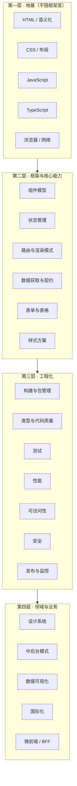

# 前端技能树

> 第三份技能树，与 [[后端技能树总纲]]、[[Agent开发工程师技能树]] 同一套方法论：四层一轴、五档掌握度、可验收判据、项目阶梯、模块页索引。总入口见 [[技术栈学习地图]]。
> 本页的默认场景：**后端团队用 FastAPI 提供接口，用 React + TypeScript 做管理台**。因此它同时回答两个问题——「专职前端要会什么」和「后端兼做前端，最少要会什么」。

## 问题 / 主题

前端是最容易被低估、也最容易被「能跑就行」掩盖的领域：入门门槛低，做好很难。常见两种极端：

- 后端视角：「前端不就是画页面、调接口？」——于是交付出一堆复制粘贴、没有加载态、没有错误态、权限写在按钮 `v-if` 里的页面。
- 前端视角：「框架会了就是会前端。」——于是换一个框架就归零，性能、可访问性、安全一概不知。

本页要把前端拆成可判断的层级：

1. 哪些是**地基**（不随框架变化）。
2. 哪些是**框架能力**（会换，但模型可迁移）。
3. 哪些是**工程化**（决定能不能长期维护）。
4. 哪些是**领域与业务**（管理台和 C 端是两套优先级）。
5. 成长分几级，每一级的判据是什么。

## 结论

1. **前端的地基不是框架，是 HTML / CSS / JavaScript / 浏览器四件事**。框架三年一换，盒模型、事件循环、渲染管线、跨域与缓存十年没变。
2. **框架要理解的是模型，不是 API**：`UI = f(state)`、单向数据流、渲染时机、组件边界。理解这些，React 与 Vue 之间只是语法差异。
3. **TypeScript 首先是契约工具**。与后端 OpenAPI 生成类型，是前后端协作成本最低的一条路；类型不是「加分的严谨」，是「减少联调返工」。
4. **工程化决定能不能长期维护**：构建、lint、测试、环境配置、发布与监控。没有这些，页面能上线但改不动。
5. **性能与可访问性是功能，不是优化项**。管理台更看重可用性（键盘、密度、加载/错误/空态），对外站点才拼 Core Web Vitals 与 SEO。
6. **管理台与 C 端是两套优先级**：管理台重表格、表单、权限、数据密度；C 端重首屏、SEO、交互体验。用 C 端的标准要求管理台，是浪费；反之是事故。

## 一、全景：四层一轴

| 层 | 内容 | 缺了会怎样 |
|---|---|---|
| 一 · 地基 | HTML、CSS、JS、TS、浏览器 | 样式靠猜、bug 靠试、性能问题无从下手 |
| 二 · 框架 | 组件、状态、路由、数据、表单、样式 | 能拼页面，但结构随规模失控 |
| 三 · 工程化 | 构建、质量、测试、性能、可访问性、安全、发布 | 能上线，不能维护；一改就崩，一出事查不到 |
| 四 · 领域 | 设计系统、中后台、可视化、国际化 | 每个页面各写各的，体验与效率都上不去 |

一条**主轴**：React + TypeScript + Vite（团队现用）。Vue 作为对照写在各节，差异点单列。

## 二、第一层：地基

### 2.1 HTML 与语义化

**必须掌握**：文档结构、常用标签的语义（`button` 与 `div` 的区别不是样式）、表单元素与提交、`label` 关联、`table` 的正确用法、`meta` 与 viewport。

**为什么重要**：语义化同时解决三件事——可访问性（屏幕阅读器）、可测试性（`getByRole`）、可维护性（结构自解释）。用 `div` 拼按钮，等于把键盘操作、焦点、回车提交全部自己实现一遍。

**自测**：不用 JS，一个表单能否用 Tab 走完、回车提交、错误提示被读屏软件读到？

**坑**：满屏 `div`；点击事件绑在 `div` 上；`table` 只用来布局。

### 2.2 CSS 与布局

**必须掌握**
- 盒模型、`box-sizing`、外边距折叠、`position` 与层叠上下文。
- Flexbox 与 Grid：一维用 Flex，二维用 Grid；`gap`、`minmax`、`auto-fit`。
- 层叠与优先级：特异性、`!important` 的代价、`@layer` 的用途。
- 响应式：媒体查询、容器查询、相对单位、移动端 viewport。
- 现代特性：CSS 变量、`:has()`、逻辑属性、`clamp()`、动画与 `prefers-reduced-motion`。

**方案选型**

| 方案 | 适合 | 代价 |
|---|---|---|
| 原生 CSS / CSS Modules | 中小项目、可控样式 | 需要自己定规范 |
| Tailwind | 快速迭代、设计 token 统一 | 类名长；团队要接受约束 |
| CSS-in-JS | 组件强绑定、动态主题 | 运行时开销、SSR 复杂度 |
| 组件库自带样式 | 中后台 | 定制成本、升级耦合 |

**自测**：一个「左固定、右自适应、内容超高滚动」的布局，能否不用 JS、不说「我试试」直接写出来？

**坑**：靠 `margin` 硬调；`z-index` 越加越大；不处理窄屏。

### 2.3 JavaScript

**必须掌握**
- 语言核心：作用域与闭包、`this`、原型链、`class` 的本质、解构与展开。
- 异步：事件循环（宏任务/微任务）、Promise、`async/await`、并发控制（`Promise.all` / `allSettled` / 竞态取消）。
- 模块：ESM 的静态分析、动态 `import()` 与代码分割。
- DOM 与事件：事件冒泡/捕获、委托、`preventDefault` 与 `stopPropagation` 的区别。
- 不可变更新：为什么 React 要求新对象，而不是原地改。

**自测**：`setTimeout(fn, 0)` 与 `Promise.then` 谁先执行，为什么？一个搜索框连续输入，如何保证最后返回的结果覆盖前面的？

**坑**：把异步当同步写；闭包捕获旧值；`==` 与隐式转换；直接改数组/对象导致视图不更新。

### 2.4 TypeScript

**必须掌握**
- 结构类型：类型兼容看形状，不看名字。
- 基础：联合/交叉、字面量类型、类型收窄（`typeof`/`in`/判别联合）、`unknown` 与 `any` 的边界。
- 泛型：约束 `extends`、默认值、在组件与 hooks 里的用法。
- 工具类型：`Partial`、`Pick`、`Omit`、`Record`、`ReturnType`，以及「不要炫技」的原则。
- `strict` 全家桶：`strictNullChecks`、`noImplicitAny`、`noUncheckedIndexedAccess`。

**团队落点**：从后端 OpenAPI 生成 TS 类型（`openapi-typescript` 一类），接口字段改名能在编译期暴露，而不是上线后白屏。契约治理见 [[API交互面与契约治理]]。

**自测**：一个接口有三种状态（加载/成功/失败），能否用判别联合让「成功时必有 data、失败时必有 error」在类型层面成立？

**坑**：到处 `any`；用 `as` 强转掩盖问题；类型写得比业务还复杂。

### 2.5 浏览器与网络

**必须掌握**
- 渲染管线：解析 → 样式 → 布局 → 绘制 → 合成；什么操作触发重排、什么只触发重绘。
- 存储：Cookie（`httpOnly`、`Secure`、`SameSite`）、`localStorage`、`sessionStorage`、IndexedDB 的适用边界。
- 跨域：同源策略、CORS 预检、携带 Cookie 的条件、开发环境代理。
- 缓存：`Cache-Control`、`ETag`、强缓存与协商缓存、CDN 与哈希文件名。
- 安全模型：XSS 的成因、CSP 的作用、点击劫持。
- DevTools：Network 面板看时序、Performance 面板看长任务、Application 面板看存储。

**自测**：登录后刷新掉登录态，可能是哪几种原因（Cookie 属性、跨域、路径、过期）？怎么逐一排除？

**坑**：把 token 放 `localStorage` 又号称安全；跨域问题靠关浏览器安全策略；缓存没版本号导致发版后仍是旧页面。

## 三、第二层：框架与核心能力

### 3.1 组件模型

**React**
- 函数组件 + props + state；单向数据流。
- Hooks 规则：只在顶层调用；依赖数组是「什么时候重新执行」的声明，不是优化开关。
- `useState` / `useEffect` / `useMemo` / `useCallback` / `useRef` / `useContext` 的适用边界。
- 列表 `key`：稳定标识，不用数组下标（会错位复用）。
- 组合优于继承：`children`、插槽式组合、受控与非受控组件。
- 渲染：重渲染的触发条件、`memo` 的收益与成本、Context 变更导致整棵子树重渲染。

**Vue 对照**：响应式系统自动追踪依赖，`ref`/`reactive`、`computed`、`watch`；单文件组件；`v-model`。心智差异在于「显式声明依赖」与「自动追踪依赖」。

**自测**：一个输入框每敲一个字都卡，怎么定位是重渲染、请求还是布局抖动？

**坑**：`useEffect` 当 `watch` 用；依赖数组漏项；用 `useMemo` 包一个几乎不耗时的计算。

### 3.2 状态管理

先把状态分三类，再谈库：

| 类型 | 例子 | 放哪 |
|---|---|---|
| 局部状态 | 弹窗开关、输入值 | 组件内 `useState` |
| 全局 UI 状态 | 当前用户、主题、侧边栏 | Context / Zustand / Redux Toolkit |
| 服务端状态 | 列表、详情、分页结果 | 数据请求库（TanStack Query / SWR） |

**核心判断**：**服务端状态不要塞进全局 store**。它有缓存、失效、重试、竞态，自己实现等于重写一个请求库。

**自测**：一个列表页的筛选条件，应该放 URL、放 store 还是放组件？说出理由（可分享、可刷新、可回退）。

**坑**：所有状态进 Redux；同一份数据在两处存导致不一致；用全局状态传父子值。

### 3.3 路由与渲染模式

| 模式 | 首屏 | SEO | 复杂度 | 适合 |
|---|---|---|---|---|
| SPA | 依赖 JS | 弱 | 低 | 管理台、登录后系统 |
| SSR | 服务端出 HTML | 强 | 中高 | 内容站、电商 |
| SSG / ISR | 构建期生成 | 强 | 中 | 文档、营销页 |

- 管理台默认 SPA 足够；不要为了「技术先进」上 SSR。
- 路由要处理：懒加载、404、权限守卫、面包屑、查询参数与页面状态同步。
- Next.js 的 App Router / Server Components 改变了「哪些代码在服务端跑」的边界，值得了解，但引入前要评估团队运维能力。

**自测**：刷新后筛选条件丢失，是路由设计问题还是状态问题？

### 3.4 数据获取与契约

**必须掌握**
- 请求封装：统一 baseURL、超时、鉴权头、错误码映射、取消。
- 三种状态：加载、成功、失败；再加「空」与「部分失败」。
- 竞态：后发先至时丢弃旧响应（`AbortController` 或请求序号）。
- 缓存与失效：列表改动后哪些查询要失效。
- 乐观更新与回滚：先改 UI 再发请求，失败要能退回。
- Mock：MSW 在浏览器/Node 层拦截，比在代码里写 `if (mock)` 干净。
- 契约：OpenAPI 生成类型 + 生成客户端；字段变更走契约评审。

**自测**：两个请求并发，用户快速切换筛选，如何保证屏幕上永远是最后一次选择的结果？

**坑**：不处理错误态；`fetch` 不检查 `response.ok`；每个页面各写一套请求逻辑。

### 3.5 表单与表格（管理台的核心）

**表单**
- 受控 vs 非受控；大表单的性能取舍。
- 校验：字段级与提交级；前端校验是体验，服务端校验才是安全。
- 错误展示：字段旁、顶部汇总、滚动定位、可访问性（`aria-invalid`、`aria-describedby`）。
- 常见库：`react-hook-form` + `zod`；把 schema 与后端契约对齐。

**表格**
- 列定义、排序、筛选、分页：**默认服务端分页**，前端分页只适合小数据。
- 大数据量：虚拟滚动（只渲染可视区）。
- 行选择、批量操作、确认与撤销。
- 空态、加载骨架、错误重试——这三样比「表格好看」重要。

**自测**：一万行数据的表格，你怎么让它不卡？筛选条件变化时，如何避免发三次请求？

### 3.6 样式方案与设计 token

- 颜色、间距、字号、圆角、阴影统一定义为 token（CSS 变量或主题配置），页面不写魔法值。
- 暗色模式：用 token 切换，而不是每个组件写两套。
- 组件样式与业务样式分离：组件库负责形态，业务负责布局。

## 四、第三层：工程化

### 4.1 构建与包管理

- Vite：开发期 ESM 按需编译，生产期打包；理解 `index.html` 入口与静态资源处理。
- 包管理：pnpm（节省磁盘、严格依赖）；锁文件必须入库。
- 环境变量：`VITE_` 前缀会打进客户端产物，**任何密钥都不能放前端环境变量**。
- 代码分割：路由级懒加载；第三方库单独分包。
- 产物分析：`rollup-plugin-visualizer` 一类，先看谁大，再谈优化。

**自测**：打包后首屏 3MB，你怎么在三步内找出最大的三个依赖？

### 4.2 类型与代码质量

- `tsc --noEmit` 放进 CI；`strict` 全开。
- ESLint / Biome + Prettier：规则统一，格式化交给工具。
- 提交前钩子（lint-staged）：只检查改动文件，保证速度。
- 约定：导入顺序、文件命名、目录结构（按功能还是按类型，团队要选一个）。

### 4.3 测试

| 层 | 工具 | 测什么 |
|---|---|---|
| 单元 | Vitest | 纯函数、格式化、校验、状态逻辑 |
| 组件 | Testing Library | 用户可见行为（按角色/文本查询，不查实现） |
| 契约 | OpenAPI 类型 + MSW | 字段与错误码是否匹配 |
| E2E | Playwright | 关键路径：登录、下单、审批 |

- 优先测「用户能感知的行为」，不测内部 state。
- E2E 只覆盖关键路径，多了会慢且脆。
- 组件测试用 `getByRole`，倒逼语义化。

**自测**：一个表单提交失败，你的测试能否覆盖「网络错误、校验失败、服务端 500」三种？

### 4.4 性能

**指标**：Core Web Vitals —— LCP（最大内容绘制）、INP（交互到下次绘制）、CLS（布局偏移）。

**手段**
- 首屏：路由懒加载、关键资源预加载、图片压缩与 `srcset`、字体加载策略。
- 运行时：长任务拆分、虚拟列表、避免布局抖动（预留尺寸）、`content-visibility`。
- 重渲染：定位真正的瓶颈再 memo；Context 拆分。
- 网络：接口合并、缓存、HTTP 缓存头、CDN。
- 度量：Lighthouse 看实验室数据，RUM 看真实用户；两者不能互相替代。

**自测**：一个页面「点按钮后 2 秒才响应」，你会先看 Performance 的哪一段？

**坑**：没测量就优化；把 `useMemo` 当银弹；图片原始尺寸直接上。

### 4.5 可访问性（a11y）

- 语义化标签、`label`、`alt`、标题层级。
- 键盘可达：Tab 顺序、焦点可见、焦点陷阱（弹窗）、Esc 关闭。
- 对比度（WCAG AA 4.5:1 正文）、不只靠颜色传达状态。
- 动效尊重 `prefers-reduced-motion`。
- 表单错误与读屏：`aria-live`、`aria-describedby`。
- 工具：axe / Lighthouse 自动检查只能覆盖一部分，键盘走查不可替代。

**自测**：只用键盘，能否完成「登录 → 筛选 → 打开详情 → 关闭弹窗」全流程？

### 4.6 安全

- **XSS**：不用 `dangerouslySetInnerHTML`；必须用时先净化（DOMPurify）；后端输出的 HTML 也要防。
- **CSRF**：Cookie 鉴权时用 `SameSite` + CSRF token；纯 Bearer 头方案没有 CSRF，但有 XSS 窃取风险。
- **Token 存哪**：`httpOnly` Cookie 抗 XSS 但不抗 CSRF；`localStorage` 反之。没有完美方案，要按威胁模型选。
- **CSP**：限制脚本来源，降低 XSS 后果；上线前先 report-only。
- **点击劫持**：`X-Frame-Options` / `frame-ancestors`。
- **依赖**：锁版本、定期审计、警惕投毒包。

**自测**：用户输入被渲染到页面、又被拼进 URL 参数，可能触发哪几类问题？

### 4.7 发布与监控

- 静态托管 + CDN：缓存头、哈希文件名、回滚到上一版。
- SSR 服务：进程管理、健康检查、边缘缓存。
- 灰度：按用户/比例放量；前端灰度常靠开关（feature flag）。
- 监控：Sentry 一类捕获 JS 错误与 source map 还原；RUM 上报 Web Vitals；把前端错误与后端 trace id 关联。
- 版本可见：页面底部或设置里显示构建版本，排障时省大量时间。

## 五、第四层：领域与业务

### 5.1 设计系统与组件库

- **三层**：设计 token（颜色/间距/字号）→ 基础组件（Button/Input/Table）→ 业务组件（工单选择器）。
- 组件库选型：Ant Design（中后台成熟）、MUI、shadcn/ui（可拥有源码）；选型看团队维护能力，不只看样式。
- Storybook：组件的独立开发与文档；也是设计-开发协作的接口。
- 版本与破坏性变更：组件库升级要像后端依赖升级一样对待。

### 5.2 中后台模式

- 布局：侧边栏 + 顶栏 + 内容区；面包屑与返回。
- 权限：路由级 + 菜单级 + 按钮级；**前端权限只是体验，服务端必须再校验**。
- 列表页模板：筛选区 → 操作区 → 表格 → 分页；筛选条件进 URL。
- 详情页模板：基本信息 + 关联数据 + 操作日志。
- 三种状态：加载（骨架屏）、空（引导动作）、错误（原因 + 重试）。
- 批量操作：选择、确认、结果反馈、部分失败处理。

### 5.3 数据可视化

- 先问「要回答什么问题」，再选图：趋势用折线、对比用柱状、占比用堆叠/饼（慎用）、分布用直方图、关系用网络图。
- 库：ECharts（功能全、中文生态好）、AntV、Recharts（React 友好）。
- 大屏：分辨率适配、动效克制、数据刷新策略。
- 可读性：轴标签、单位、图例、空数据提示，比炫酷重要。

### 5.4 国际化与本地化

- 文案抽离、复数与性别、日期/数字/货币格式（`Intl`）。
- 布局要为长文案留余量；从第一天就抽文案，比后期补便宜。

### 5.5 微前端与 BFF

- **微前端**（qiankun / Module Federation）：解决的是「多团队独立发布」的组织问题，不是技术先进性问题。代价是隔离、通信、依赖重复、调试复杂。和微服务一样，先问组织是否真的需要。
- **BFF**（Backend for Frontend）：为前端聚合接口、裁剪字段。FastAPI 很适合做 BFF，但要注意别把业务逻辑搬进去，形成第二个真相源。边界见 [[DDD模块边界与数据协作]]。

### 5.6 体验验收

一个页面交付前，逐项过：

- 加载：首屏有反馈，不是白屏。
- 错误：网络失败、权限不足、服务异常都有可读提示与下一步动作。
- 空：没有数据时告诉用户为什么、能做什么。
- 可恢复：误操作可撤销，表单失败不丢输入。
- 键盘：全流程可完成。
- 窄屏：至少不横向溢出。

## 六、与后端技能树的映射

| 后端模块 | 在前端的用法 | 增量 |
|---|---|---|
| 计算机网络 | 复用 | 浏览器缓存、CORS、Cookie、CDN |
| 数据库 | 弱相关 | 字段设计直接影响表单与表格；分页/排序要服务端支持 |
| 软件工程 | 复用 | 组件测试、CI、版本与回滚 |
| 安全 | 权重升高 | XSS、CSRF、CSP、token 存储 |
| 可观测性 | 复用 | 前端 RUM + 错误监控，与后端 trace 打通 |
| 设计模式 | 复用 | 组合、策略（渲染分支）、观察者（订阅） |
| API 与契约 | 复用 | OpenAPI → TS 类型/客户端，契约先行 |
| DDD / 建模 | 部分复用 | 领域术语决定页面信息架构 |

一句话：**后端转前端，缺的不是接口能力，而是浏览器模型与交互细节**；补上这两块，管理台可以做到很高质量。

## 七、成长路径：四级

| 级别 | 能独立做什么 | 判据 | 典型产出 | 常见停留原因 |
|---|---|---|---|---|
| **L1 会用** | 改页面、接接口、调样式 | 能独立完成一个 CRUD 页面 | 一个业务页面 | 只会复制粘贴，不理解状态与渲染 |
| **L2 会搭** | 独立搭一个中后台 | 路由、权限、表单、表格、三态齐全，能交给用户 | 一个完整管理台 | 页面间复制失控，不抽象组件 |
| **L3 会设计** | 组件库、设计系统、性能与可访问性基线 | 能让多人一致地开发 | 组件库、规范、脚手架 | 只做业务，不沉淀 |
| **L4 会定义** | 架构选型（SSR/微前端/BFF）、体验策略 | 能改变交付效率或业务指标 | 前端架构与团队机制 | 技术视角压过产品与成本 |

### 跃迁信号

- **L1 → L2**：同一段逻辑在五个页面各写一遍，改一处漏四处 → 需要组件抽象与状态边界。
- **L2 → L3**：多人协作风格不一致、重复造组件、性能问题反复出现 → 需要设计系统与规范。
- **L3 → L4**：技术方案都对，但交付慢、体验差、业务不买单 → 需要架构与产品视角。

### 不同起点的路径

| 起点 | 优势 | 缺口 | 建议 |
|---|---|---|---|
| 后端工程师 | 接口、数据、工程习惯 | CSS、浏览器、交互细节 | 从管理台切入：TS + React + 表格表单，先求「三态齐全」 |
| 设计师 | 视觉与交互 | JS、工程化 | 补 TS 与组件化，从设计系统入手 |
| 零基础 | 无包袱 | 全部 | HTML/CSS/JS → TS → React → 工程化，按项目推进 |

## 八、项目阶梯

| # | 项目 | 练到什么 | 验收标准 |
|---|---|---|---|
| 1 | 静态页 + 表单 | HTML/CSS/JS、校验、可访问性 | 键盘可完成，窄屏不溢出 |
| 2 | 接 FastAPI 的 CRUD 管理台 | 路由、请求封装、三态、分页 | 登录 + 列表 + 详情 + 编辑全通，错误可恢复 |
| 3 | 权限与可视化 | RBAC 路由、按钮权限、图表 | 越权接口被服务端拒绝；图表能回答问题 |
| 4 | 组件库 + 设计 token | 抽象、Storybook、暗色 | 新页面只用现有组件与 token 即可完成 |
| 5 | 性能与可访问性达标 | CWV、懒加载、键盘走查 | Lighthouse 达标，关键流程无鼠标可用 |
| 可选 | SSR / BFF / 微前端 | 架构取舍 | 能说清为什么需要，以及不用的代价 |

## 九、面试与简历

**简历写指标**

- 差：「使用 React + Ant Design 开发管理台」。
- 好：「把工单列表首屏从 4.2s 降到 1.3s，包体积减少 45%；建立 12 个业务组件，新页面交付从 3 天降到 1 天」。

**高频考点**：事件循环与闭包、原型与 `this`、Promise 与并发控制、浏览器渲染流程、HTTP 缓存与跨域、React hooks 依赖与渲染机制、key 的作用、状态管理选型、性能排查路径、XSS/CSRF、可访问性。

**反问**：有没有设计系统？浏览器支持范围？发布与回滚流程？前端监控覆盖到什么程度？

## 十、学习方法与反模式

**方法**
1. **以页面为单元验收**：一个页面必须过「加载/错误/空/键盘/窄屏」五项。
2. **读 DevTools**：Network 看时序、Performance 看长任务、Elements 看布局。比看教程有效。
3. **先照抄再抽象**：同类页面写到第三遍再抽组件，避免过早抽象。
4. **读源码与规范**：MDN、React 文档、WCAG 是最可靠的三份资料。

**反模式**
- 框架驱动：先选框架再找问题。
- 复制粘贴：五个页面五份逻辑。
- 全局状态滥用：什么都进 store。
- `useEffect` 万能：把派生状态、事件响应都塞进 effect。
- 只测 happy path：加载、错误、空态从不覆盖。
- 为微前端而微前端：把组织问题当技术问题。

**验收四问**（与前两份一致）：能讲清、能画图、能排障、能选型。

## 十一、本页怎么继续长（索引表）

规则同 [[后端技能树总纲]]：写完一个模块页，把状态改成 `[[页面名]]`，并回填 `index.md` 与 `log.md`，同时在 [[技术栈学习地图]] 登记。

| # | 模块 | 计划页面 | 优先级 | 依赖 | 状态 |
|---|---|---|---|---|---|
| 1 | 地基 | HTML 与 CSS 布局 | P0 | — | 待写 |
| 2 | 地基 | JavaScript 核心与事件循环 | P0 | — | 待写 |
| 3 | 地基 | TypeScript 类型系统 | P0 | #2 | 待写 |
| 4 | 地基 | 浏览器渲染、缓存与跨域 | P0 | — | 待写 |
| 5 | 框架 | React 组件与 Hooks | P0 | #2、#3 | 待写 |
| 6 | 框架 | 状态管理与数据获取 | P1 | #5 | 待写 |
| 7 | 框架 | 中后台页面模式（表格/表单/权限） | P0 | #5 | 待写 |
| 8 | 工程 | 前端工程化与构建 | P1 | — | 待写 |
| 9 | 工程 | 前端测试 | P1 | #5 | 待写 |
| 10 | 工程 | 性能优化与 Core Web Vitals | P1 | #4 | 待写 |
| 11 | 工程 | 可访问性实践 | P1 | #1 | 待写 |
| 12 | 工程 | 前端安全 | P1 | #4 | 待写 |
| 13 | 领域 | 设计系统与组件库 | P2 | #1、#5 | 待写 |
| 14 | 领域 | 数据可视化 | P2 | #5 | 待写 |
| 15 | 领域 | 微前端与 BFF | P2 | #8 | 待写 |

## 引用的页面

- [[技术栈学习地图]] — 三份技能树的总入口与扩容规则
- [[前端技术栈全景]] — 选型速查与 2026-11 现状核对；本页讲「怎么学」，它讲「当下用什么」
- [[后端技能树总纲]] — 同一方法论的母页；第六节是两者的映射
- [[API交互面与契约治理]] — OpenAPI 契约与版本，前端类型生成的依据
- [[DDD模块边界与数据协作]] — 管理台与 BFF 的边界、权限与数据所有权

## 外部参考

- MDN Web Docs — HTML/CSS/JS/浏览器 API 的权威参考
- React 官方文档（含 Hooks 与 Server Components）
- TypeScript Handbook
- web.dev — Core Web Vitals 与性能指南
- WCAG 2.2（W3C）
- Vite、Vitest、Testing Library、Playwright、MSW 文档
- Ant Design / shadcn/ui 文档（中后台与可拥有源码两条路线）
- 《Refactoring UI》— 视觉与布局的工程化表达

## 尚存的缺口 / 待研究

- [ ] 缺少本团队管理台的真实页面案例（工单列表、试验详情）作为对照，目前只有通用模式。
- [ ] 设计资源与协作流程缺失：token 谁定、设计稿怎么交付、走查怎么做。
- [ ] 浏览器支持范围未确定，直接影响可用语法与 polyfill 策略。
- [ ] 性能基线没有实测数据：当前管理台的首屏、包体积、Core Web Vitals 是多少。
- [ ] 前端监控与后端 trace 打通的具体方案未验证。
