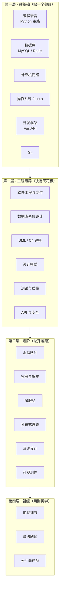
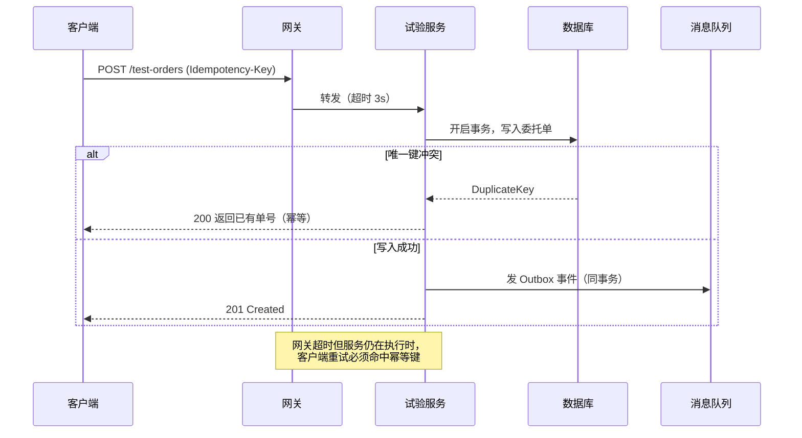

# 后端技能树总纲

> 本页是「后端」这一整棵树的**总索引与判据页**，不是教程。每一块只写到「该学什么、学到什么程度算会、怎么验证、下一张页面叫什么」，具体内容由后续的模块页承载，写完就回本页登记。
> 原始输入：2026-11-25 用户提供的博主视频摘要（讲后端技术栈分层与学习顺序，无 raw 文件）。本页在原文基础上补了三样原文没有的东西：**工程素养层**（软件工程、数据库设计、UML/C4、设计模式、测试与安全）、**Python/FastAPI 主线**、**可验收的学习判据**。

## 问题 / 主题

原文回答的是「后端要学什么」：六大硬基础、六大进阶、三类可暂缓、三阶段路线。这份清单在方向上是对的，但它有三个隐含前提，直接照抄会走偏：

1. **它是 Java 求职视角**。Spring Cloud、JVM、Maven 生态占了默认位置。本团队是 Python + FastAPI，要素能一一映射，但写法、生态成熟度、性能模型都不同（见第七节对照表）。
2. **它按「面试可知」筛选过**。软件工程、测试策略、数据库设计、UML/C4、设计模式这些**决定工作后天花板**的内容一条没提，因为它们不好出八股题。这是取舍，不是能力模型的完整版。
3. **它的阶段一目标是「能找到初级岗」，不是「能独立干活」**。真正让人从初级走向中级的，是能不能独立做方案、能不能定位线上问题，这两件事都长在工程素养层上。

所以本页要解决的不是「再列一份清单」，而是：**把清单变成有层级、有判据、可持续生长的树**。

## 结论

1. **技能树是四层 + 一条主轴，不是平铺的清单**。地基（语言/数据/网络/系统/框架/Git）→ 工程素养（软件工程、数据库设计、建模、模式、测试、安全）→ 进阶（MQ、容器、微服务、分布式、系统设计、可观测）→ 暂缓（前端、刷题、云服务）。上一层的缺失会在下一层以「排障慢、方案浅」的形式暴露。
2. **判断一块知识该不该现在学，用两把尺子**：它能不能扩大你**排障时的可选动作**？能不能扩大你**设计时的可选方案**？两个都不能的，就是暂缓项。
3. **「会」有五个刻度**：知道 → 会用 → 懂原理 → 能排障 → 能设计。面试通常考后三档，升职只看后两档。本页每个模块都按这五档给自测题。
4. **阶段一的目标是「闭环」，不是「广度」**：能独立把一个服务从建表、写接口、加鉴权、写测试、打镜像、部署、看日志走完一遍，比学过十个框架更有价值。
5. **Python 主线要正视短板**：GIL、动态类型、生态碎片。对策不是换语言，而是用类型标注 + Pydantic 边界 + 多进程/异步分工 + 统一模板把短板补成纪律。
6. **本页只留索引与判据**。每写完一个模块页，回来把「状态」列改成 `[[页面名]]`，正文不在这里重复——否则这页会烂成第二个目录。

## 一、全景：四层一轴



| 层 | 内容 | 什么时候学 | 缺了会怎样 |
|---|---|---|---|
| 一 · 硬基础 | 语言、数据库、网络、OS、框架、Git | 立刻，且要反复回炉 | 连一个请求为什么慢都说不清，只能猜 |
| 二 · 工程素养 | 需求、测试、交付、建模、模式、安全 | 与第一层并行，做第一个真实项目时就要 | 代码能跑但改不动；方案只能照抄；线上出事只会重启 |
| 三 · 进阶 | MQ、容器、微服务、分布式、系统设计、可观测 | 入职后按业务需要逐块补 | 岗位停在「写接口」，做不了架构决策 |
| 四 · 暂缓 | 前端、刷题、云产品 | 有明确触发信号再学 | 短期几乎没有代价，提前学反而挤占第一层 |

一条**主轴**贯穿四层：Python / FastAPI 技术栈。一条**横轴**同样贯穿：工程素养。两者的具体展开见第三节与第七节。

## 二、第一层：六大硬基础

> 每块给四样东西：核心目标、必须掌握、Python/FastAPI 落点、五档自测。自测答不上来就说明还停在「会用」。

### 2.1 编程语言（Python 为主线，Java/Go 作对照）

**核心目标**：能读懂框架源码，能写出别人改得动的模块。不是背语法。

**必须掌握**
- 语法与语义：作用域、可变/不可变、异常与异常链、`with`、迭代协议。
- 面向对象：组合优先于继承、抽象基类与 `Protocol`、数据类、魔法方法（`__eq__`/`__hash__`/`__repr__`）。
- 集合与复杂度：list/dict/set 的底层与均摊复杂度，什么场景该用 `deque`、`heapq`、`Counter`。
- 并发模型：线程、进程、协程三者的适用边界与切换成本。
- 内存与生命周期：引用计数、循环引用、生成器惰性求值、大对象驻留。

**Python / FastAPI 落点**
- 类型标注是硬要求：`list[str]`、`X | None`、`Protocol`、`TypeVar`、`ParamSpec`，配 `mypy --strict` 或 pyright。
- 装饰器要能自己写：它是 FastAPI 的中间件、鉴权、限流的共同底座。
- `async/await` 要理解到「协程是事件循环调度的对象，不是线程」，否则会在 async 路由里调阻塞库。
- 包管理用 `uv`（或 Poetry）锁版本；项目用 `src/` 布局；格式化与 lint 用 ruff。

**五档自测**
- 会用：能手写一个带参数、保留元信息的装饰器。
- 懂原理：能解释 `dict` 为什么平均 O(1)、扩容时发生什么。
- 能排障：能判断一段代码是 CPU 密集还是 IO 密集，并说出该换线程、进程还是协程。
- 能设计：能为一组变化点设计出「用 Protocol 约束 + 依赖注入替换」的结构，而不是靠继承。

**常见坑**：把 Python 当脚本写——没有类型、没有分层、模块级全局状态、业务逻辑塞进路由函数。

### 2.2 数据库（基础版）

**核心目标**：能写对 SQL，能看懂一条 SQL 为什么慢。

**必须掌握**
- SQL：多表连接、子查询与 `EXISTS`、窗口函数、聚合与分组。
- 索引：B+ 树结构、聚簇索引与二级索引、回表、最左前缀、覆盖索引、索引选择性。
- 事务：ACID、四种隔离级别、MySQL 默认 RR 下的 MVCC 与间隙锁、幻读到底怎么产生。
- 锁：行锁/表锁/意向锁、死锁的成因与排查（`SHOW ENGINE INNODB STATUS`）。
- 诊断：`EXPLAIN` / `EXPLAIN ANALYZE`、慢查询日志、连接池。
- Redis：五种基本类型与典型场景、过期策略、持久化、缓存穿透/击穿/雪崩、分布式锁（`SET NX PX` + Lua 释放）。

**Python / FastAPI 落点**
- SQLAlchemy 2.0：分清 Core 与 ORM，知道什么时候不该用 ORM。
- 异步驱动：`asyncpg` / `aiomysql`，session 生命周期必须跟请求绑定，不能跨请求复用。
- 迁移：Alembic，所有 DDL 走版本化脚本，禁止手工改生产表。
- N+1：默认 `lazy="select"` 会在序列化时炸出 N 条查询，用 `selectinload` 显式预加载。
- 连接池：池大小 × worker 数 ≤ 数据库 `max_connections`，这是容器化后最常见的打爆数据库原因。

**五档自测**
- 会用：能写出一条带分组、排序、分页、去重的统计 SQL。
- 懂原理：能解释「为什么给 `status` 建了索引还是全表扫」。
- 能排障：给一条 3 秒的 SQL，能在 10 分钟内定位是缺索引、回表过多还是锁等待。
- 能设计：能说清这个业务该用唯一索引兜底还是应用层判重，代价分别是什么。

**常见坑**：把 Redis 当数据库用；用 `SELECT *`；在索引列上做函数运算；长事务占着连接不放。

### 2.3 计算机网络

**核心目标**：接口出问题时，能判断是 DNS、TCP、TLS、网关还是应用层。

**必须掌握**
- TCP：三次握手、四次挥手、`TIME_WAIT` 与 `CLOSE_WAIT`、滑动窗口、拥塞控制、粘包。
- UDP：无连接、不可靠，什么时候反而合适（实时音视频、DNS、QUIC）。
- HTTP：报文结构、方法与幂等性、状态码语义（尤其 301/302/304/401/403/409/422/429/499/502/504）、Header（`Connection`、`Cache-Control`、`ETag`、`Retry-After`）。
- HTTPS：对称 + 非对称 + 证书链，TLS 1.3 的握手轮次，证书过期是最常见的「突然全站 502」。
- DNS：递归与迭代、TTL、CNAME、解析链路。
- 架构侧：反向代理、负载均衡、CDN、长连接与连接复用。

**Python / FastAPI 落点**
- `httpx` 客户端：显式设置 `timeout`（连接/读/写分开）、连接池上限、重试策略；默认无超时是事故根源。
- 理解 ASGI：uvicorn 收到的是已解析的 HTTP 请求，但 `X-Forwarded-For`、`Host`、`scheme` 需要正确信任代理头才能拿到真实客户端信息。
- 流式响应与 SSE：`StreamingResponse` 的心跳与断开检测。

**五档自测**
- 会用：能用 `curl -v` 看清一次请求的每一跳。
- 懂原理：能解释为什么 `TIME_WAIT` 多不等于有 bug。
- 能排障：502 / 504 / 499 分别该往哪一层查？
- 能设计：给定「客户端 → CDN → 网关 → 服务」的链路，能标出每一层的超时应该设成多少、为什么。

**常见坑**：只背八股，不理解「超时 × 重试 × 幂等」三者必须一起设计。

### 2.4 操作系统与 Linux

**核心目标**：能在没有图形界面的机器上，用命令定位 CPU、内存、磁盘、网络、文件描述符的问题。

**必须掌握**
- 进程与线程：地址空间、上下文切换、调度、僵尸进程、`fork`/`exec`。
- 协程与 IO 模型：阻塞/非阻塞、`select`/`poll`/`epoll`、Reactor 模式。
- 内存：虚拟内存、页表、页缓存、swap、OOM Killer、RSS 与 VSZ 的区别。
- 文件与 IO：文件描述符上限、`ulimit`、零拷贝。
- 用户态与内核态：系统调用、为什么频繁 `syscall` 会慢。
- 命令：`top`/`htop`、`ps`、`ss`、`lsof`、`df`/`du`、`iostat`、`vmstat`、`strace`、`tcpdump`、`journalctl`。

**Python / FastAPI 落点**
- asyncio 的事件循环底层就是 epoll：一个阻塞调用会卡住整个 worker 上的所有协程。
- 容器里的 `nproc` 读的是宿主机 CPU 数，worker 数要按 cgroup limit 算，不能按 `os.cpu_count()`。
- 内存泄漏排查：`tracemalloc`、`objgraph`，以及区分「Python 堆增长」与「RSS 不降」（glibc 不归还）。

**五档自测**
- 会用：能一条命令找出占满 80 端口的进程并杀掉。
- 懂原理：能解释「内存没满但进程被 OOM Kill」的几种可能。
- 能排障：CPU 100% 时，能区分是业务死循环、GC、还是大量小 IO。
- 能设计：能为一个 IO 密集服务和一个 CPU 密集服务分别决定进程/线程/协程模型与副本数。

**常见坑**：只看 `top` 的 CPU 百分比，不看 load、上下文切换和 iowait。

### 2.5 开发框架（FastAPI 为主轴）

**核心目标**：理解框架替你做了什么，而不是只会写路由。

**必须掌握（FastAPI）**
- 路由：`APIRouter` 分组、路径/查询/请求体参数、响应模型、状态码。
- 校验：Pydantic v2 模型、字段约束、自定义校验器、`model_config`、序列化与别名。
- 依赖注入：`Depends` 的解析顺序、`yield` 依赖的清理语义、`lru_cache` 与「同一请求内缓存」的区别、`dependency_overrides` 用于测试。
- 中间件：执行顺序（洋葱模型）、CORS、请求 ID、耗时统计、异常兜底。
- 生命周期：`lifespan` 初始化连接池、预热缓存、注册信号处理；不要用已废弃的 `on_event`。
- 后台任务：`BackgroundTasks` 只适合「请求返回后随手一做」，重活要交给队列。
- 异常：统一异常处理器 + 统一错误响应体 + 业务错误码，不要把 traceback 返回给客户端。
- 文档：OpenAPI 自动生成是契约的一部分，`response_model` 决定文档准不准。

**对照（知道概念即可）**
- Spring Boot：IOC 容器、AOP、声明式事务、拦截器/过滤器。FastAPI 没有容器，DI 是函数级的，AOP 用装饰器与中间件近似。
- Gin：中间件链、`Context` 传递、绑定与校验。

**五档自测**
- 会用：能写出一个带分页、鉴权、统一错误、OpenAPI 描述完整的 CRUD。
- 懂原理：同步路由函数是在线程池里跑的，这对连接池和共享状态意味着什么？
- 能排障：一个接口偶发 500，能按「中间件 → 依赖 → 校验 → 路由 → 数据库」的顺序逐层缩小。
- 能设计：能说清哪些逻辑放依赖、哪些放 service、哪些放中间件，边界判据是什么。

**常见坑**：在 async 路由里调用 `requests`、`time.sleep`、同步 ORM；把事务边界交给路由函数；把 Pydantic 模型同时当领域模型和数据库模型。

### 2.6 Git

**核心目标**：敢做任何操作，因为知道怎么恢复。

**必须掌握**
- 对象模型：commit / tree / blob，分支只是指针，这让「撤销」变得可推理。
- 日常：`add -p`、`commit --amend`、`rebase -i`、`cherry-pick`、`stash`。
- 协作：trunk-based（短分支 + 频繁合并）与 Git Flow 的取舍；PR 粒度；冲突解决。
- 救援：`reset --soft/--mixed/--hard`、`revert`、`reflog`（终极后悔药）、`bisect` 定位引入 bug 的提交。
- 规范：提交信息写「为什么」而不是「改了什么」；一个提交一件事。

**五档自测**
- 会用：能把 5 个零碎提交压成一个干净的提交。
- 能排障：已经 push 到共享分支的错误提交，该 `revert` 还是 `reset`？为什么？
- 能设计：能为团队定一套分支策略与合并规则，并说明它如何配合 CI。

**常见坑**：在共享分支上 `force push`；把格式化改动和逻辑改动混在一个提交里。

## 三、第二层：工程素养（原文没讲，决定天花板）

这一层不按「技术点」组织，而按「一个系统从想法到线上要过的关」组织。它和第一层并行学，做第一个真实项目时就该开始。

### 3.1 软件工程与交付

**核心目标**：让「写完代码」变成「可持续地交付」。

| 环节 | 要掌握的东西 | 判据 |
|---|---|---|
| 需求 | 用户故事、验收标准、范围切分、MVP | 能把一句模糊需求拆成 3 条可验收的条目 |
| 设计 | 模块边界、接口先行、失败路径 | 动手前能画出组件图与关键时序图 |
| 实现 | 命名、分层、单一职责、可读性优先 | 新人能在 30 分钟内看懂你模块的入口 |
| 评审 | Code Review 清单：正确性、边界、错误处理、测试、可观测性、安全 | 评审意见能落到具体行，而不是「感觉不好」 |
| 测试 | 测试金字塔、测试替身、契约测试 | 核心逻辑有单测，关键链路有集成测试 |
| 交付 | CI/CD、制品版本、环境一致性、灰度、回滚 | 任何一次发布都能在 5 分钟内回滚 |
| 运维 | 值班、故障分级、复盘（blameless postmortem） | 每次故障产出至少一条可执行的改进项 |
| 演进 | 重构节奏、技术债台账、ADR / RFC | 每个重要决策都有书面理由与备选方案 |

**测试策略（单独强调）**
- 金字塔：单元测试多、集成测试中、E2E 少。比例不是教条，判据是「反馈速度」与「置信度」的平衡。
- 单元测试测**行为**不测实现；一个测试里只应有一个人为失败原因。
- 集成测试用真实依赖的轻量替代：`testcontainers` 起 MySQL/Redis，比 mock 更能发现真问题。
- 契约测试：OpenAPI schema diff + 针对 schema 的属性测试（schemathesis），防止「后端改字段、前端炸」。
- 覆盖率是**发现盲区**的工具，不是 KPI；100% 覆盖率也可能全是断言为空的测试。

**FastAPI 落点**：`pytest` + `pytest-asyncio` + `httpx.AsyncClient`；用 `dependency_overrides` 替换数据库与鉴权；数据库测试用事务回滚或独立 schema；`ruff` + `mypy` + `pre-commit` 在提交前拦住低级错误；CI 里跑 lint → type → test → build 四段。

**自测**：你的项目从 `git push` 到线上可访问，中间有几步、每步失败会怎样、怎么回滚？答不全就说明交付链还没闭环。

### 3.2 数据库系统设计

> 2.2 是「会用数据库」，这里是「会设计数据」。两者差着一个职级。

**核心目标**：让数据模型撑得住业务变化，让容量增长时不推倒重来。

**1）建模三层**
- 概念模型：实体与关系，对应领域语言（试验委托单、样件、工单）。
- 逻辑模型：表、主外键、约束、范式化程度。
- 物理模型：字段类型、索引、分区、存储引擎。

**2）范式与反范式**
- 三范式解决写入异常与冗余；反范式解决读性能。判据是**读写比**与**一致性容忍度**，不是「范式越高手越强」。
- 常见反范式：冗余统计字段、宽表、快照字段（下单时把商品名价格存进订单行，这是业务正确性要求，不是偷懒）。

**3）键的设计**

| 方案 | 优点 | 代价 | 适用 |
|---|---|---|---|
| 自增 ID | 短、有序、索引友好 | 暴露业务量、分库后冲突 | 单库内部表 |
| UUIDv4 | 全局唯一、无中心 | 随机写、索引膨胀、可读性差 | 低频、分布式生成 |
| UUIDv7 / 雪花 | 全局唯一 + 趋势有序 | 依赖时钟或机器号 | 高并发主键 |
| 业务编号 | 人可读、可对账 | 生成规则复杂、易变 | 对外单号（与主键分离） |

原则：**主键与业务编号分离**。主键只负责唯一与索引，单号负责对外沟通。

**4）索引设计**
- 先问查询模式，再建索引；没有查询支撑的索引是负债（写入放大 + 优化器误判）。
- 联合索引顺序按「等值在前、范围在后、排序字段跟上」；最左前缀不是背规则，是 B+ 树的有序性决定的。
- 覆盖索引避免回表；但索引列太多会让索引本身变成大表。
- 定期清理冗余索引（`pt-duplicate-key-checker` 或 `sys.schema_redundant_indexes`）。

**5）事务与并发**
- 事务边界应放在**用例（application service）**层，不是每个 repository 方法各自开事务。
- 长事务 = 锁持有时间长 + undo 膨胀 + 主从延迟。批量操作要分批提交。
- 死锁不是 bug，是并发系统的常态；要做的是**固定加锁顺序** + 短事务 + 死锁重试。
- 隔离级别的选择是业务问题：对账要可重复读，计数器可以读已提交。

**6）分库分表（什么时候才需要）**
- 触发信号：单表过亿且索引优化无效、单库写入打满、单机容量到顶。**不要提前分**。
- 垂直拆分：按业务拆库（订单库、试验库），本质是边界划分，和 [[DDD模块边界与数据协作]] 的数据所有权是同一件事。
- 水平拆分：选分片键（用户 ID、租户 ID、试验单号），保证 80% 查询能带分片键。
- 跨分片问题：分页、聚合、排序、事务。方案是「冗余视图表 / 异步汇总 / 两次查询归并」，每种都有一致性代价。
- 扩容：一致性哈希或「逻辑分片 → 物理库」两层映射；迁移用双写 + 全量校验 + 灰度切读。

**7）演进与迁移**
- 所有 DDL 版本化（Alembic / Flyway）；大表变更走在线 DDL 或影子表。
- 兼容式变更顺序：先加字段（可空）→ 双写 → 回填 → 切读 → 删旧字段。任何一步都可回滚。
- 迁移必须有**校验**：行数、金额汇总、抽样比对。

**8）NoSQL 选型**

| 类型 | 代表 | 适合 | 不适合 |
|---|---|---|---|
| KV / 缓存 | Redis | 会话、计数、排行榜、锁 | 复杂查询、强持久 |
| 文档 | MongoDB | 结构多变的内容、聚合读 | 多表事务 |
| 搜索 | Elasticsearch | 全文检索、日志、聚合分析 | 作为主存储 |
| 时序 | InfluxDB / TDengine | 指标、传感器数据 | 事务型业务 |
| 图 | Neo4j | 多跳关系 | 大规模写入 |
| 列式 | ClickHouse | OLAP 分析 | 高频点更新 |

**自测**：给定「试验委托单 + 样件 + 检测项 + 报告」四张表，能说出主键、外键、索引、哪些字段该冗余、数据量到 10 亿时先动哪里。

### 3.3 UML 与架构建模

**核心目标**：用图**做决策和沟通**，不是用图交作业。

**先问图的用途**：给谁看（自己 / 团队 / 领导 / 外部）、要促成什么决定（拆分？上线？排障？）。用途决定画哪张图、画到多细。

**UML 实用子集**（14 种图里真正常用的 7 种）

| 图 | 回答什么问题 | 什么时候画 |
|---|---|---|
| 用例图 | 谁、能做什么 | 需求边界讨论 |
| 类图 | 领域里有哪些概念、什么关系 | 领域建模 |
| 时序图 | 一次交互的先后、失败路径 | 接口设计、故障复盘 |
| 状态图 | 对象生命周期与非法迁移 | 订单/工单/设备状态 |
| 活动图 | 业务流程的分支与并行 | 流程梳理、审批链 |
| 组件图 | 模块与依赖方向 | 架构评审 |
| 部署图 | 进程、主机、网络、端口 | 上线方案 |

**C4 模型**：讲架构时比 UML 更好用，因为它按「受众的放大倍数」分层。
- L1 Context：系统与外部角色/系统的关系（给非技术人看）。
- L2 Container：应用、数据库、队列、网关（给团队看）。
- L3 Component：容器内部的模块与职责（给开发看）。
- L4 Code：类级细节（**基本不画**，代码本身就是）。

**本库的实践约定**
- 图用 mermaid 写进 Markdown：可 diff、可评审、和文字同仓演进；草图用 Excalidraw。
- 一张图只回答一个问题；标题就是那个问题。
- 必标四样：**边界**（谁负责）、**同步/异步**、**失败路径**、**数据所有权**。
- 图要带版本：架构图进 git，改架构就改图，和图一起 review。

**示例：一条带失败路径的时序图**（这是本库要求的最低标准）



**ADR（架构决策记录）**：比图更容易被忽略、但更重要。模板四段：背景 / 决策 / 备选方案 / 后果（好的与坏的）。一个决策一个文件，编号递增，永不删除，被推翻时新增一条指向旧条目。

**从需求到图的完整链路**：本节讲的是「有图怎么画」，需求、用例、流程、状态、数据到类图/原型/验收的端到端协同建模流程，见 [[AI时代从需求到开发的统一建模方法]]。

**自测**：给你负责的服务画一张 C4 L2 图；再画一次「创建委托单」的时序图，必须包含超时、重试、幂等三条路径。画不出来说明你对系统的理解还停在代码层。

### 3.4 设计模式

**核心目标**：获得一套**共同词汇**，让「这里该抽一个策略」这句话能被同事立刻理解。模式是描述变化的语言，不是目标。

**GoF 精选 8 个（其余按需查）**

| 模式 | 解决的变化 | Python 里的常见形态 |
|---|---|---|
| 策略 Strategy | 算法可替换 | 一等函数、`Protocol`、注册表 |
| 工厂 Factory | 创建逻辑集中 | 函数返回实例、字典注册表 |
| 观察者 Observer | 一对多通知 | 回调列表、事件总线、信号 |
| 适配器 Adapter | 接口不兼容 | 包装类、防腐层（ACL） |
| 装饰器 Decorator | 动态叠加职责 | 函数装饰器、中间件 |
| 模板方法 Template | 固定骨架、可变步骤 | 抽象基类、高阶函数 |
| 责任链 Chain | 依次处理、可中断 | 中间件链、管道 |
| 门面 Facade | 简化子系统 | service 层、应用服务 |

**Python 化**：很多模式被语言特性吸收了——一等函数替代策略，`@decorator` 语法替代装饰器模式，`Protocol` 替代接口，`contextmanager` 替代模板方法的一部分，`dataclass` 替代一堆样板类。**照搬 Java 的 23 模式是反模式**。

**企业级模式（真正天天用的）**
- Repository：隔离持久化细节；但别做成「每个表一个 CRUD 接口」的空壳。
- Unit of Work：一个用例一个事务边界。
- 依赖注入：构造函数/函数参数注入，而不是全局单例。
- CQRS：读写模型分离，适合读多写多且形态差异大的场景，不适合所有系统。
- Saga / Outbox / ACL：跨服务一致性与边界隔离，已在 [[DDD模块边界与数据协作]] 与 [[API交互面与契约治理]] 展开。

**反模式清单**：为模式而模式、过早抽象、每层都加一个接口、把简单函数拆成三个类、Java 式 getter/setter。

**自测**：在你现在的项目里找出 3 处模式使用，说明它挡住了哪种变化；再找出 1 处「抽象了但没人受益」的代码。

### 3.5 API、安全与鉴权

**API 设计**：资源建模、幂等（`Idempotency-Key`）、分页（游标优于 offset）、错误码分层（HTTP 语义 + 业务码）、版本策略。完整内容见 [[API交互面与契约治理]]，协议选型见 [[通讯协议对比与选型]]。

**安全必须掌握**
- 认证 vs 授权：你是谁 / 你能做什么，两件事不能混在一个中间件里。
- OAuth2 / OIDC：授权码 + PKCE 是主流；客户端凭证用于服务间。
- JWT 的坑：无法主动撤销（要配短过期 + 刷新令牌 + 黑名单）、`alg=none` 与算法混淆、时钟偏移、把敏感信息塞进 payload。
- 常见漏洞：SQL 注入（参数化查询）、越权 IDOR（每个查询都要带租户/用户条件）、SSRF、反序列化、路径穿越、依赖供应链漏洞。
- 密码存储：argon2id 或 bcrypt，永远不要自己实现哈希。
- 密钥管理：环境变量只是底线，生产用密钥管理服务；密钥不进 git、不进镜像、不进日志。
- CORS 不是安全边界；限流要按用户与 IP 双维度。

**FastAPI 落点**：`OAuth2PasswordBearer` + 依赖注入做鉴权；Pydantic 做输入白名单；统一异常处理器不泄漏内部信息；`slowapi` 或网关层限流；定期 `pip-audit` / `uv pip list --outdated`。

**自测**：一个接口只允许「本租户的、有编辑权限的」用户改数据，你的代码里有几处可能漏掉校验？能否用一条依赖统一兜住？

## 四、第三层：进阶六大

> 这一层不是求职前必须，而是入职后按业务触发。触发信号比学习顺序更重要——没遇到问题的学习留存率极低。

### 4.1 消息队列

**解决什么**：异步解耦、流量削峰、广播、跨服务最终一致。

**必须掌握**：投递语义（at-most-once / at-least-once / exactly-once 的现实含义）、幂等消费、顺序与分区、积压与扩容、死信与重放、事务消息与 Outbox、消息格式演进。

**判据**：用了 MQ 之后，你是否能回答「重复消费会怎样」「消费失败谁来兜底」「消息积压 100 万条怎么处理」。

**Python 落点**：轻量任务用 Celery / ARQ / Dramatiq；高吞吐事件用 Kafka（`confluent-kafka` 或 `aiokafka`）；注意 Celery 与 asyncio 的边界——不要在 worker 里混用事件循环。

**坑**：把 MQ 当数据库用；没有死信队列；消费逻辑不幂等；消息体里塞整个实体导致契约僵化。

### 4.2 容器与编排

**解决什么**：环境一致、快速交付、弹性伸缩。

**必须掌握**
- Docker：镜像分层与缓存、多阶段构建、非 root 用户、`.dockerignore`、健康检查、镜像体积。
- Kubernetes：Pod / Deployment / Service / Ingress、ConfigMap / Secret、探针（liveness / readiness / startup 的区别）、资源 requests/limits、HPA、滚动更新与回滚。
- 排障：`kubectl logs/describe/exec/port-forward`，CrashLoopBackOff、OOMKilled、ImagePullBackOff、探针失败。

**Python 落点**：镜像用 `python:3.12-slim` + uv 安装依赖，多阶段构建只带运行时；worker 数按 CPU limit 算；`uvicorn --workers` 与 K8s 副本数不要重复放大。

**触发信号**：手工部署出现「我本地是好的」；需要多人共享测试环境；需要按流量扩缩。

### 4.3 微服务

**解决什么**：团队边界、独立发布、独立伸缩、故障隔离。

**先读这条**：**模块化单体优先**。拆分的前提是边界清楚（见 [[DDD模块边界与数据协作]]、[[测试业务DDD上下文划分]]），否则只是把耦合从进程内搬到网络上，还多了一堆分布式问题。

**必须掌握**：服务注册发现、配置中心、网关、熔断/限流/降级、链路追踪、契约版本、数据所有权、跨服务查询（API 组合 vs 数据冗余 vs CQRS）。

**Python 现实**：Python 的微服务生态不如 Java 完整（没有 Spring Cloud 的等价全家桶）。常见组合是 K8s Service + 网关（Kong/APISIX/Traefik）+ OpenTelemetry + 少量框架（FastAPI + httpx + tenacity/pybreaker）。这意味着**基础设施承担了更多职责**，团队要有人懂 K8s 和网关。

**判据**：拆完之后，一次故障的定位时间变短了还是变长了？如果变长，说明可观测性没跟上，不该拆。

### 4.4 分布式理论

**必须掌握**
- CAP 与 BASE 的真实含义：分区容忍是前提，实际是在 C 与 A 之间按场景取舍。
- 一致性模型：强一致、线性一致、顺序一致、最终一致——能举出各自在业务里的例子。
- 共识：Raft 的直觉（leader + 日志复制 + 多数派），不必会实现，但要能解释为什么需要奇数节点。
- 分布式锁：Redis 锁的边界（主从切换丢锁）、 fencing token、ZooKeeper/etcd 的差异。
- 分布式事务：2PC（阻塞、协调者单点）、TCC（补偿、空回滚/悬挂）、Saga（长流程、无隔离）、本地消息表/Outbox（最常用、最简单）。
- 分布式 ID：雪花算法、号段模式、UUIDv7。
- 一致性哈希：虚拟节点、扩缩容时的数据迁移量。
- 幂等与重试：所有分布式问题的第一性答案。

**诚实的话**：绝大多数业务系统不需要共识算法，需要的是**幂等 + 重试 + 最终一致 + 对账**。先把这四件事做对，比学 Raft 有用。

### 4.5 系统设计

**核心目标**：给定约束（QPS、数据量、一致性要求、团队规模），能给出可落地的架构并说清取舍。

**必须能做的动作**：容量估算（QPS/存储/带宽）、读写路径设计、缓存策略、分片策略、失败与降级、监控指标、上线与回滚。

**练习阶梯**

| 案例 | 核心矛盾 | 要练的点 |
|---|---|---|
| 短链 | 读多写少 + 发号 | 缓存、ID 生成、分片、301/302 取舍 |
| 秒杀 | 瞬时高并发 + 库存 | 限流、预扣、MQ 削峰、防超卖、幂等 |
| 信息流 | 扇出 | 推拉结合、缓存、分页一致性 |
| 订单 | 状态机 + 一致性 | 状态机、幂等、Saga/Outbox、对账 |
| 文件服务 | 大对象 | 对象存储、分片上传、CDN、病毒扫描 |
| 通知 | 多通道 + 重试 | 模板、去重、退订、可达性、降级 |

**方法**：先写约束 → 画 L2 图 → 算容量 → 找单点 → 给三个取舍方案 → 选一个并说明为什么。面试和评审都按这个顺序。

### 4.6 可观测性

**三支柱**：日志（发生了什么）、指标（有多少）、追踪（在哪儿慢）。

**必须掌握**
- 日志：结构化（JSON）、级别语义、trace_id 贯穿、采样、脱敏、成本控制。
- 指标：四个黄金信号（延迟、流量、错误、饱和度）；Prometheus 的 counter/gauge/histogram 区别，直方图分桶决定 P99 准不准。
- 追踪：OpenTelemetry、span 语义、跨服务上下文传播、异步任务的链路。
- SLO：SLI 定义、错误预算、告警按**症状**而非原因（「支付成功率低于 99%」而不是「CPU 高于 80%」）。

**FastAPI 落点**：`prometheus-fastapi-instrumentator` 暴露 `/metrics`；OpenTelemetry 自动埋点 + 手动给外部调用加 span；`structlog` 输出 JSON 日志；请求 ID 中间件把 trace_id 注入日志。

**判据**：线上报警后，你能否在 5 分钟内回答「影响谁、多大范围、哪个依赖、从什么时候开始」。

## 五、第四层：暂缓三类

| 内容 | 为什么能缓 | 什么信号说明该补了 | 最低限度 |
|---|---|---|---|
| 前端细节 | 后端只需能联调、能读懂报错 | 需要独立交付管理台；或团队没有前端 | 懂 HTML/CSS 盒模型、浏览器 DevTools、CORS/Cookie、能读 React 组件 |
| 算法刷题 | 与日常工作弱相关，遗忘快 | 面试前 2–3 个月；或遇到真实性能问题 | 高频 100 题 + 复杂度分析；平时每周 2 题保持手感 |
| 云厂商产品 | 产品迭代快，记了会过期 | 项目要用；或要考厂商认证 | 先学抽象（对象存储/托管数据库/队列/网关/CDN），再学具体厂商的对应产品 |

**判断原则**：暂缓不等于不学，而是**把它放在「有明确触发信号」的队列里**，而不是放在焦虑清单里。

## 六、三阶段路线

### 6.1 阶段表

| 阶段 | 时间感 | 主线 | 产出物 | 毕业信号 | 先别碰 |
|---|---|---|---|---|---|
| 一 · 闭环 | 0–6 个月 | 语言 → 数据库 → 网络/OS → FastAPI → Git | 一个真正上线的小服务 | 能在 30 分钟内定位一个 500 或慢请求；能安全地加一张表并迁移 | 微服务、K8s、分布式事务 |
| 二 · 模块 | 入职 0–12 个月 | 业务建模 + 测试 + CI/CD + 缓存 + MQ + Docker | 独立负责一个模块 | 能独立写技术方案并过评审；能处理一次线上故障并复盘 | 分库分表、Service Mesh |
| 三 · 系统 | 1–3 年 | 分布式 + 系统设计 + 可观测 + 数据演进 | 一次架构演进（拆分/扩容/重构） | 能做容量评估、能决定拆不拆、能为取舍负责 | 跟风上新框架 |

### 6.2 项目阶梯（比看课有用）

| # | 项目 | 练到什么 | 对应模块 |
|---|---|---|---|
| 1 | 带鉴权的 TODO/工单服务 | 建表、迁移、CRUD、鉴权、测试、Docker | 2.1–2.6、3.1 |
| 2 | 带缓存与异步任务的内容服务 | Redis、Celery/ARQ、分页、限流 | 2.2、4.1 |
| 3 | 短链服务 | ID 生成、分片、缓存、302 | 4.5 |
| 4 | 秒杀/库存扣减 | 并发控制、MQ 削峰、幂等、防超卖 | 4.1、4.4、4.5 |
| 5 | 拆出第二个服务 | 契约、网关、链路追踪、数据所有权 | 4.3、4.6 |

每个项目都要写一页笔记进本库——**输出是检验理解的最低成本方式**。

### 6.3 时间怎么分

- 60% 做项目（哪怕是小项目），30% 补原理，10% 写输出。
- 一周一个可交付的小目标，而不是「这周看完某本书」。
- 同一时间只主攻一块，其他块保持「知道在哪查」即可。

## 七、Python / FastAPI 横展主轴

### 7.1 语言与工具链清单

| 能力 | 必须 | 进阶 | 验收 |
|---|---|---|---|
| 类型系统 | 标注、`Optional`、`Protocol`、泛型 | `TypeVar`、`ParamSpec`、`overload` | `mypy --strict` 无错 |
| 异步 | `async/await`、`asyncio.gather`、超时 | 任务取消、背压、事件循环策略 | 能写出不阻塞的并发请求 |
| 并发 | 线程池、进程池、GIL 边界 | 共享内存、`multiprocessing` 序列化成本 | 能为 CPU/IO 任务选对模型 |
| 数据模型 | dataclass、Pydantic v2 | 自定义校验、序列化钩子 | 边界模型与领域模型分离 |
| 包管理 | uv / Poetry、锁文件 | 私有源、可选依赖分组 | 冷环境一条命令可复现 |
| 质量工具 | ruff、mypy、pre-commit | CI 门禁、增量检查 | 提交前自动拦截 |

### 7.2 FastAPI 能力地图

```text
客户端
  │ HTTPS
  ▼
Nginx / 网关         TLS 终止、限流、路由、鉴权前置
  │ HTTP
  ▼
uvicorn（ASGI）      N 个 worker 进程，每进程一个事件循环
  ▼
Starlette            中间件栈（洋葱模型）
  ▼
FastAPI              路由匹配 → 依赖注入 → Pydantic 校验
  ▼
路由函数             async 直接跑；def 丢进线程池
  ├── Service 层     业务规则、事务边界、权限判断
  ├── Repository     SQLAlchemy / 外部客户端
  └── 基础设施       Redis、MQ、对象存储、第三方 API
```

| 能力 | 关键点 | 常见错误 |
|---|---|---|
| 依赖注入 | `Depends`、`yield` 清理、请求级缓存 | 把依赖写成全局单例，状态跨请求泄漏 |
| 校验 | Pydantic v2、`response_model`、别名 | 请求模型当领域模型用 |
| 数据库 | SQLAlchemy 2.0 async、Alembic | session 跨请求复用；N+1 |
| 事务 | 用例层开事务、失败回滚 | 每个 repository 各自 commit |
| 异步 | 全链路 async 或明确隔离 | async 路由里调同步库 |
| 后台任务 | `BackgroundTasks` 只做轻活 | 用它跑几分钟的报表 |
| 测试 | `httpx.AsyncClient`、`dependency_overrides` | 只测 happy path |
| 观测 | `/metrics`、OTel、结构化日志 | 日志无 trace_id |
| 部署 | 多阶段镜像、非 root、健康检查 | 镜像里带编译工具链 |
| 文档 | OpenAPI 即契约 | `response_model` 缺失导致文档失真 |

### 7.3 Java 生态 ↔ Python 生态对照

| 能力 | Java / Spring | Python / FastAPI |
|---|---|---|
| Web 框架 | Spring Boot | FastAPI |
| 依赖注入 | Spring IOC 容器 | `Depends`（函数级，无容器） |
| 参数校验 | Bean Validation | Pydantic v2 |
| ORM | JPA / Hibernate | SQLAlchemy 2.0 |
| 迁移 | Flyway / Liquibase | Alembic |
| 构建依赖 | Maven / Gradle | uv / Poetry |
| 测试 | JUnit + Mockito | pytest + pytest-asyncio + httpx |
| 异步 | CompletableFuture / WebFlux | asyncio / Starlette |
| 定时任务 | `@Scheduled` / Quartz | APScheduler / Celery beat |
| 消息 | Spring Kafka | confluent-kafka / aiokafka / Celery |
| 观测 | Actuator + Micrometer | prometheus-fastapi-instrumentator + OTel |
| 网关 | Spring Cloud Gateway | Kong / APISIX / Traefik / Nginx |
| 配置 | Spring Cloud Config | pydantic-settings + 配置中心 |

**映射的边界**：FastAPI 提供的是「HTTP + 校验 + 文档 + 依赖」，**不提供**事务管理、AOP、服务治理。这些要靠 SQLAlchemy 的 session 管理、装饰器/中间件、K8s 与网关补齐。理解这一点，才不会拿 Spring 的期待去怪 FastAPI「功能少」。

### 7.4 Python 的五个短板与对策

| 短板 | 表现 | 对策 |
|---|---|---|
| GIL | CPU 密集无法利用多核 | 多进程、原生扩展（NumPy/Polars）、把计算外移成独立服务 |
| 动态类型 | 重构易错、接口漂移 | 全量类型标注 + mypy strict + Pydantic 守边界 |
| 启动与内存 | 冷启动慢、单进程内存高 | 精简镜像、预热、合理 worker 数、监控 RSS |
| 依赖地狱 | 传递依赖冲突 | 锁文件、固定版本、镜像统一构建 |
| 生态碎片 | 同类库太多、团队各写各的 | 收敛为一套项目模板与选型清单 |

补充：CPython 近年提供了 free-threading 的实验构建，方向是去掉 GIL，但第三方库兼容与性能特征仍需评估，短期内不能当作架构前提。

### 7.5 一份可照做的项目骨架

```text
backend/
├── pyproject.toml          # 依赖、工具配置（ruff/mypy/pytest）
├── uv.lock
├── Dockerfile              # 多阶段：builder + runtime
├── alembic.ini
├── migrations/
├── src/app/
│   ├── main.py             # 组装：路由、中间件、lifespan
│   ├── core/               # 配置、日志、安全、异常基类
│   ├── api/
│   │   ├── deps.py         # 公共依赖：当前用户、数据库 session
│   │   └── v1/
│   │       ├── orders.py
│   │       └── parts.py
│   ├── domain/             # 实体、值对象、领域服务（纯 Python，无框架依赖）
│   ├── application/        # 用例编排、事务边界
│   ├── infrastructure/     # SQLAlchemy、Redis、MQ、外部 HTTP
│   └── schemas/            # Pydantic 请求/响应模型
├── tests/
│   ├── unit/
│   ├── integration/
│   └── conftest.py         # 数据库夹具、依赖覆盖
└── ops/
    ├── compose.yaml
    └── grafana/
```

这个骨架与 [[DDD模块边界与数据协作]] 里的目录示例一致：外层按限界上下文分包，内层按 DDD 分层。小项目可以只保留 `api / service / repository` 三层，但要保留**依赖方向向内**这条规则。

## 八、怎么学：四个方法，三个反模式

### 8.1 四个方法

1. **项目驱动**：每学一块，必须找到一个能用到它的真实需求。学 MQ 就去做「下单后异步发通知」，学缓存就去做「热点数据读优化」。
2. **源码阅读**：挑一个你天天用的库读核心路径（FastAPI 的依赖解析、SQLAlchemy 的 session、Starlette 的中间件栈）。目标不是读完，是能回答「它怎么做到的」。
3. **排障日志**：每次线上/本地疑难问题，记三行：现象、假设、验证结果。半年后这是你最有价值的知识库。
4. **输出倒逼**：写进本库。能写清楚 = 真懂；写不清楚的地方就是没懂的地方。

### 8.2 三个反模式

- **收藏夹式学习**：存了 200 篇文章，一个没跑过。资料的边际价值在第二个之后急剧下降。
- **教程循环**：跟着视频敲完三个项目，离开教程写不出第四个。判据是「关掉教程能否从空目录开始」。
- **只学不用**：学了 K8s 但团队没有集群，三个月后归零。等触发信号。

### 8.3 每块的验收模板

学完一个模块，用四句话自检：
1. **能讲清**：用三句话向非同行解释它解决什么问题。
2. **能画图**：能画出它在你系统里的位置与数据流。
3. **能排障**：能列出它最常见的三种故障与定位步骤。
4. **能选型**：能在两个方案之间说出取舍，并给出适用条件。

四句都答得出，才算到「能设计」；只答得出前两句，是「会用」。

## 九、本页怎么继续长（索引表）

规则：**写完一个模块页 → 把「状态」改成 `[[页面名]]` → 更新 `index.md` 与 `log.md`**。本页永远只保留判据与索引，不复制正文。

| # | 模块 | 计划页面 | 优先级 | 依赖 | 状态 |
|---|---|---|---|---|---|
| 1 | 语言 | Python 语言核心与类型系统 | P0 | — | 待写 |
| 2 | 语言 | Python 并发与 asyncio | P0 | #1 | 待写 |
| 3 | 框架 | FastAPI 工程实践 | P0 | #1、#2 | 待写 |
| 4 | 数据 | SQL 与索引优化 | P0 | — | 待写 |
| 5 | 数据 | 事务、锁与隔离级别 | P0 | #4 | 待写 |
| 6 | 数据 | Redis 与缓存设计 | P0 | #4 | 待写 |
| 7 | 数据 | 数据库设计与分库分表 | P1 | #4、#5 | 待写 |
| 8 | 网络 | HTTP/HTTPS 与排障手册 | P0 | — | 待写 |
| 9 | 网络 | TCP/IP 与 DNS | P1 | #8 | 待写 |
| 10 | 系统 | Linux 与进程/内存排障 | P0 | — | 待写 |
| 11 | 工程 | Git 与协作流程 | P0 | — | 待写 |
| 12 | 工程 | 软件交付与 CI/CD | P1 | #11 | 待写 |
| 13 | 工程 | 测试策略与 pytest | P1 | #3 | 待写 |
| 14 | 工程 | 架构建模：UML 与 C4 | P1 | — | 待写 |
| 15 | 工程 | Python 设计模式与企业模式 | P2 | #14 | 待写 |
| 16 | 工程 | API 安全与鉴权 | P1 | [[API交互面与契约治理]] | 部分 |
| 17 | 进阶 | 消息队列与异步任务 | P1 | #6 | 待写 |
| 18 | 进阶 | Docker 与 Kubernetes | P2 | #10 | 待写 |
| 19 | 进阶 | 微服务与模块化单体 | P2 | [[DDD模块边界与数据协作]] | 部分 |
| 20 | 进阶 | 分布式系统理论 | P2 | #17 | 待写 |
| 21 | 进阶 | 系统设计案例集 | P1 | #17、#20 | 待写 |
| 22 | 进阶 | 可观测性体系 | P1 | #10 | 待写 |

优先级判据：P0 = 每天都在用且不懂就出错；P1 = 决定能否独立负责模块；P2 = 触发信号出现再写。

## 引用的页面

- [[技术栈学习地图]] — 三份技能树的总入口与扩容规则
- [[API交互面与契约治理]] — 契约、版本、Outbox、ACL，对应本页 3.5 与 4.3
- [[通讯协议对比与选型]] — HTTP/gRPC/Webhook/MQ 的分层与选型，对应 2.3 与 4.1
- [[DDD模块边界与数据协作]] — 模块边界、数据所有权、模块化单体，对应 3.2、4.3、7.5
- [[测试业务DDD上下文划分]] — 本团队业务下应用边界划分的具体案例
- [[Agent开发工程师技能树]] — 同一套方法论的 Agent 方向姊妹篇：四层能力、四级成长与项目阶梯

## 外部参考

- Martin Kleppmann《数据密集型应用系统设计》（DDIA）— 分布式与数据系统的第一性参考
- 《深入理解计算机系统》（CSAPP）— 操作系统与内存模型
- 《计算机网络：自顶向下方法》— 网络分层与协议
- Luciano Ramalho《流畅的 Python》— 语言层与数据模型
- Martin Fowler《重构》《企业应用架构模式》— 代码演进与 Repository/UoW
- Eric Evans《领域驱动设计》— 边界与统一语言
- Google《SRE 工作手册》— SLI/SLO 与故障管理
- 《MySQL 实战 45 讲》— 索引、事务、锁的工程视角
- FastAPI、SQLAlchemy 2.0、Alembic、Kubernetes 官方文档
- C4 model（c4model.com）、OWASP Top 10

## 尚存的缺口 / 待研究

- [ ] 本文每个模块只有自测题，没有参考答案与判据细化——需要随模块页补上。
- [ ] 缺少针对本团队制造测试业务的数据库建模案例（委托单、样件、检测项、报告），目前只能从通用原则外推。
- [ ] Python 生态在微服务治理（熔断、限流、配置中心）上的成熟方案与边界未验证，需实际选型对比。
- [ ] 阶段时间感（0–6 月 / 0–12 月）是经验值，缺少针对「在职学习」与「脱产学习」的差异化估算。
- [ ] 未讨论 AI 辅助编码对技能结构的影响：哪些能力被削弱、哪些被放大。
