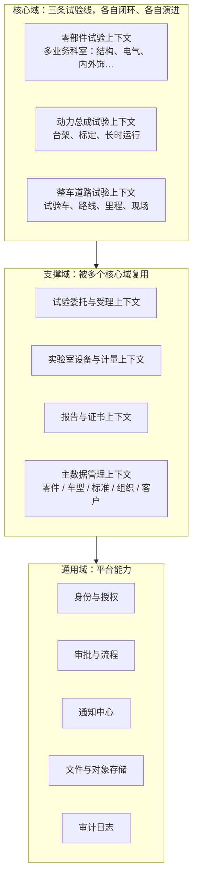
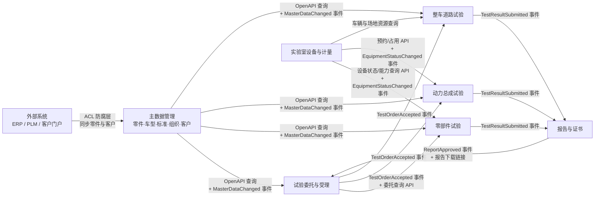
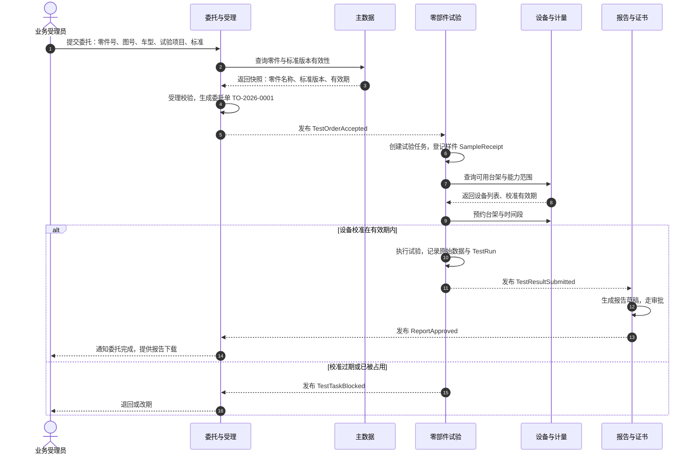
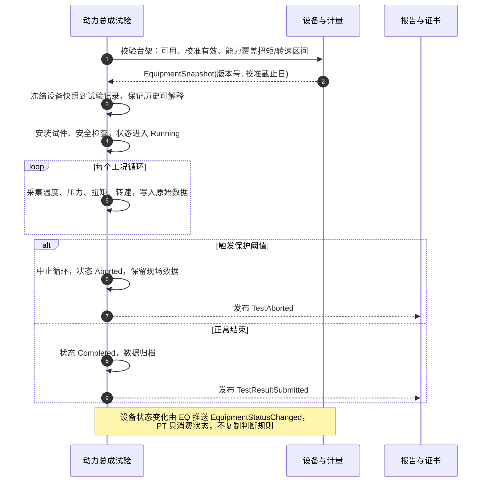
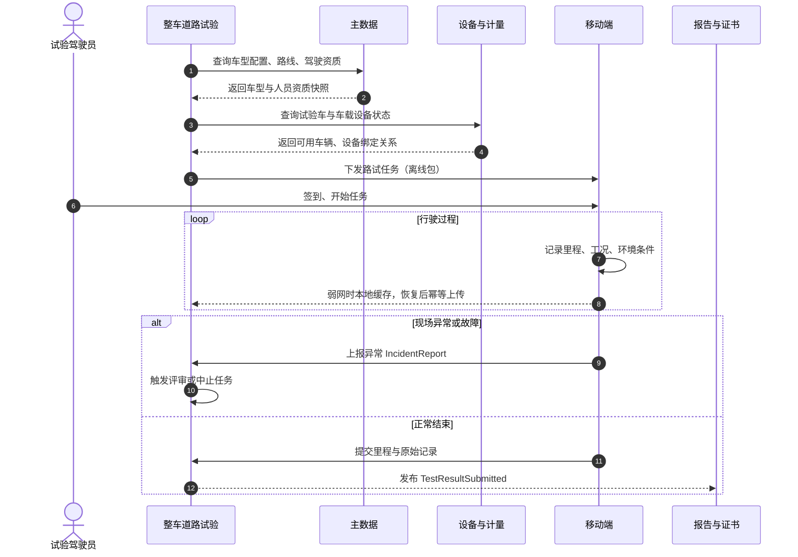
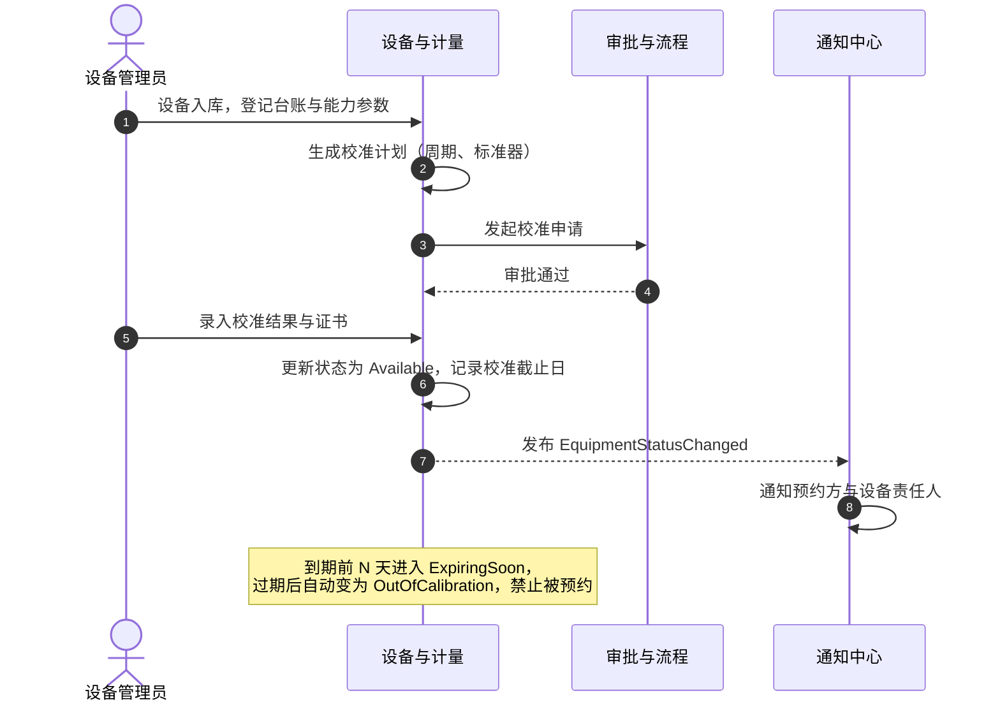
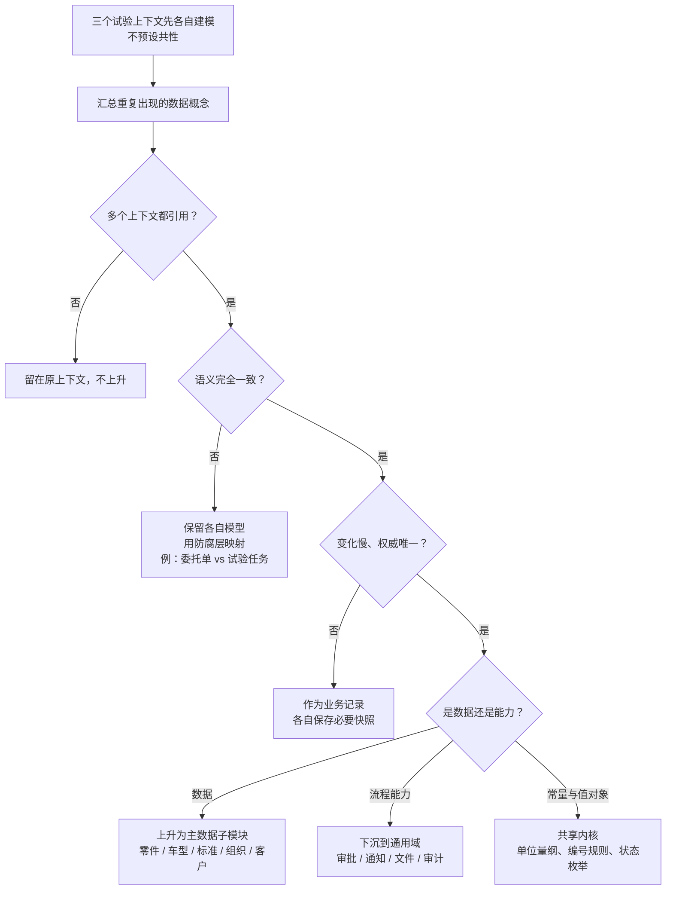
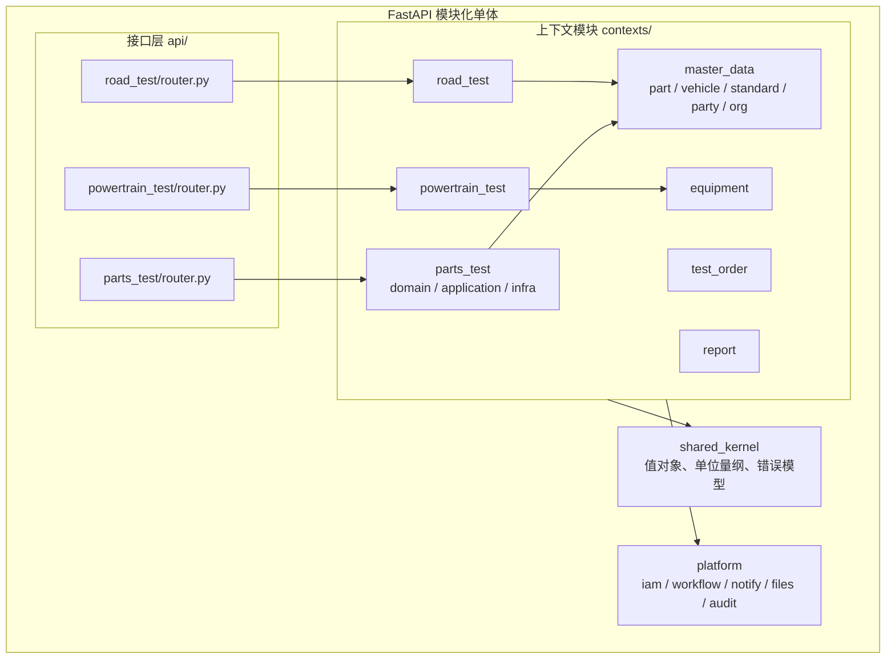
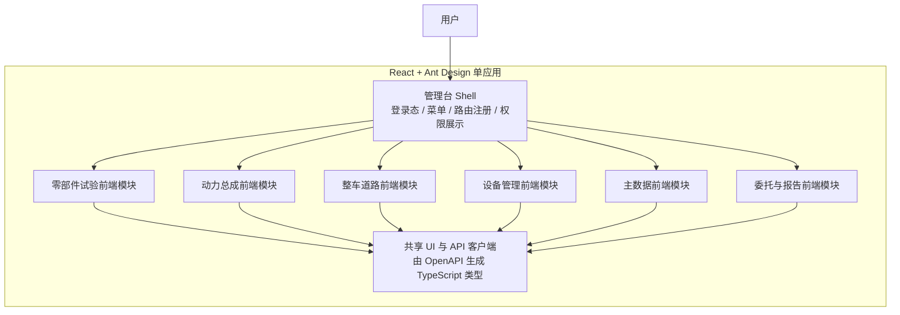

# 测试业务DDD上下文划分

> 本篇是 [[DDD模块边界与数据协作]] 的落地案例：把方法论套到具体测试业务上——零部件试验、动力总成试验、整车道路试验、实验室设备管理——画出它们各自的边界的、拆出公因式、并给出跨上下文的 HTTP 与事件契约。

## 前提与假设

以下为按常见试验业务推演的模型，**不是已确认的现状**，落地前需要逐条核对：

- 业务主链路：委托 → 受理 → 试验任务 → 执行 → 报告 → 交付。
- 零件、车型、试验标准、组织人员、客户供应商由企业主数据或 ERP/PLM 权威维护，本系统不重新发明。
- 设备范围包括台架、试验车、车载采集设备、计量器具。
- 三条试验线各有独立的排期、执行记录和报告出口；它们之间不直接互相调用。

如果某条与实际不符（例如委托单本身由客户门户持有、整车路试没有独立报告），只需替换对应节点，分层结构不变。

## 一、子域划分：先分核心、支撑、通用

关键判断：

- **三条试验线必须各自成为上下文**，而不是合并成一个“试验管理”。它们的聚合根不同：零部件试验的核心是「试验任务 + 样件」，动力总成是「台架运行 + 工况循环」，整车道路是「路试任务 + 里程/现场事件」。合并会得到一个谁都改不动的巨型模型。
- **设备管理是支撑域，不是核心域**。它服务于三条线，但又必须拥有自己的状态机（可用 / 校准中 / 过期 / 维修 / 停用），所以独立成上下文，而不是塞进每个试验上下文里各写一遍。
- **主数据是支撑域里的公共子模块集合**，不等于“所有共享表的垃圾桶”。详见第五节。

## 二、上下文映射：谁发布、谁消费

箭头方向 = 发布方 → 消费方。所有跨上下文写操作都走对方的公开用例，不直接写对方的表。

关系类型说明：

| 关系 | 出现在哪里 | 含义 |
|---|---|---|
| 客户-供应者 | 三个试验上下文 ← 主数据、设备 | 下游提需求，上游保证契约稳定 |
| 发布语言 | OpenAPI + 事件 schema | 跨上下文只认契约，不认内部模型 |
| 防腐层 ACL | ERP/PLM → 主数据 | 外部字段语义不污染内部模型 |
| 共享内核 | 仅值对象与常量 | 保持最小，见第四节 |
| 遵奉者 | 暂不推荐 | 若主数据由集团统一强制，才考虑 |

## 三、四个场景的具体调用链

### 场景一：零部件试验（多科室并行）

注意：多业务科室的差异（试验项目目录、审批节点、报告模板）放在**零部件上下文内部**按科室配置，不上升为主数据，也不拆成三个上下文。

### 场景二：动力总成试验（长时占用 + 安全联锁）

这条线的特殊点：**试验对设备的依赖是“能力 + 有效期”**，不是简单 ID 引用。所以设备上下文要暴露结构化能力（量程、精度、通道数），试验上下文做匹配判断；设备只负责“是否可用”。

### 场景三：整车道路试验（现场 + 弱网）

这条线的特殊点：**移动端离线包 + 幂等上传**是上下文内部的集成问题，不上升为跨服务契约；路线和场地可以复用设备上下文的“资源”模型，但“路试任务”绝不能放进设备上下文。

### 场景四：设备与计量（横向支撑）

### 订阅方式：HTTP 查询 + 事件订阅

```mermaid
sequenceDiagram
    autonumber
    participant P as 发布方上下文
    participant O as Outbox 投递器
    participant S as 订阅方

    S->>P: 注册订阅：回调 URL、事件类型、签名密钥
    P->>P: 业务事务内写业务表 + Outbox
    O->>O: 扫描未投递事件
    O->>S: POST 事件（带事件 ID、签名、重试次数）
    alt 2xx
        S-->>O: 确认
        O->>O: 标记已投递
    else 5xx 或超时
        O->>O: 指数退避重试，超限进入死信
    end
    S->>S: 按事件 ID 幂等去重
    Note over S: 事件丢失或顺序异常时，用查询 API 做对账
```

## 四、共享内核只放两类东西

共享内核一旦变大就会变成“隐形耦合”。这里建议只放：

1. **值对象与常量**：试验编号 / 报告编号规则、单位与量纲、时间窗、状态枚举、金额。
2. **技术契约基元**：结果包装、错误码模型、分页参数、事件信封（event_id、occurred_at、version）。

不放：订单、任务、设备、零件这类有生命周期和业务规则的实体，它们属于各自的上下文或主数据。

## 五、提取公因式：把交集模型剥离成主数据子模块

三个试验上下文会自然长出重复概念。正确做法不是一开始就抽公共库，而是**先各自建模，再按同一套判据回收**。

主数据上下文内部再按生命周期分子模块：

| 子模块 | 内容 | 权威来源 | 变化频率 |
|---|---|---|---|
| `part` | 零件、图号、物料号、版本 | ERP/PLM 经 ACL | 中 |
| `vehicle` | 车型、配置、整车编码 | PLM | 中 |
| `standard` | 试验标准、方法、版本、适用范围 | 标准化部门 | 低，但必须冻结版本 |
| `party` | 客户、供应商 | ERP/CRM | 中 |
| `org_person` | 组织、人员、岗位、资质 | HR / IdP | 低 |

反例，明确不发生：

- 不要把「试验任务」上升为主数据——它在三条线里语义不同（样件测试 / 台架运行 / 路试里程），强行统一会造出一个万能状态机。
- 不要把「设备预约」放进主数据——它是业务记录，有时间和冲突规则，属于设备上下文。
- 不要让主数据上下文变成“什么都管”的公共服务——它只管**被引用且权威唯一**的慢变数据。

## 六、数据权威矩阵

| 数据对象 | 权威上下文 | 消费方 | 同步方式 | 一致性要求 |
|---|---|---|---|---|
| 零件 / 物料 / 图号 | 主数据 | 零部件、动力、报告 | HTTP 查询 + MasterDataChanged | 最终一致，报告存快照 |
| 车型 / 配置 | 主数据 | 整车道路、报告 | 同上 | 同上 |
| 试验标准 / 方法 / 版本 | 主数据 | 三个试验上下文 | 发布时冻结版本号 | 报告必须记录版本 |
| 组织 / 人员 / 资质 | 主数据 | 全部 | 查询 + 事件 | 资质到期需及时感知 |
| 客户 / 供应商 | 主数据 | 委托、报告 | 查询 + 事件 | 最终一致 |
| 委托单 | 委托与受理 | 三条试验线、报告 | TestOrderAccepted + 查询兜底 | 事件可靠投递 |
| 试验任务 / 原始记录 | 各试验上下文 | 报告、看板 | TestResultSubmitted | 各自拥有，不共享写 |
| 设备台账 / 校准 / 预约 | 设备与计量 | 三条试验线 | 查询 API + 状态事件 | 状态变更准实时 |
| 试验车 / 场地 / 路线 | 设备与计量（资源子域） | 整车道路 | 查询 | 最终一致 |
| 报告 / 证书 | 报告与证书 | 委托、客户 | ReportApproved + 下载链接 | 发布后不可变，编号唯一 |

四条边界判断规则：

1. **“能不能做这个试验”由试验上下文判断**：设备上下文只给能力和状态，不替业务做可行性决策。
2. **“校准过期能不能继续测”由设备上下文定义**：状态机归它，试验上下文只读，不复制规则。
3. **委托单 ≠ 试验任务**：前者是受理事实，后者是执行排期事实，不共享模型，只共享 ID 引用。
4. **报告必须存业务快照**：零件名、标准版本、设备编号要写进报告，不能只存 ID，否则主数据改名后历史报告无法解释。

## 七、代码与前端如何落位

### 后端：模块化单体的包结构

约束：

- 每个上下文一个包，内部再分 `domain / application / infrastructure / api`；MVC 的 Controller 只出现在 `api/`，不承载业务规则。
- 每张表有明确归属包；跨包只调 application 用例或读对方发布的投影，不 join 对方表。
- 上下文之间的数据库访问走 repository 接口，拆服务时把实现换成 HTTP 客户端即可，业务代码不动。

### 前端：一个管理台 Shell，按业务域组合子前端

- 路由由 Shell 统一注册，子前端只暴露入口和菜单声明，不直接改 Shell。
- 每个子前端自带状态与 API 客户端；只有跨模块共享的登录态、当前组织、权限点提升到 Shell。
- 后端拆服务后，前端模块对应改 API base URL 即可；只有当团队需要独立发布、且模块契约稳定时，才考虑 Module Federation。

## 八、演进路线

| 阶段 | 形态 | 触发条件 |
|---|---|---|
| 一 | 单 FastAPI 应用 + 单 React 管理台 | 当前默认；先跑通上下文边界 |
| 二 | 动力总成 / 整车道路独立服务 | 长时任务、现场部署、数据量或独立发布节奏形成瓶颈 |
| 三 | 主数据、设备独立成服务 | 被更多系统（不止本管理台）消费，或需要独立 SLO |
| 四 | 前端微前端 | 团队必须独立发布，且模块公共契约已稳定 |

拆分顺序建议：**先拆最“重”的（动力总成、道路试验），主数据和设备最后拆**。前者是资源和故障隔离收益最大，后者是契约最需要稳定。

## 待确认

- 零部件试验的多科室差异，目前按“同一上下文内配置”处理；如果科室间连报告模板和审批链都完全不同，考虑拆成两个上下文。
- 试验标准是否由标准化部门独立系统维护；若是，主数据上下文只做镜像。
- 整车路试是否需要独立于报告上下文的“现场事件”闭环（故障、事故、召回）。
- 设备预约是集中排期还是各试验线自行协调；这决定设备上下文是“资源提供方”还是“排期权威”。
- 是否需要对外交付客户门户；若是，委托与报告上下文要提供对外 API 和脱敏视图。

## 引用的页面

- [[DDD模块边界与数据协作]]：方法论来源——模块化单体、数据所有权、HTTP/事件分工、React 协作与 MCP 边界。

## 外部参考

- [Microsoft：微服务领域分析](https://learn.microsoft.com/azure/architecture/microservices/model/domain-analysis)
- [Microsoft：上下文映射](https://learn.microsoft.com/azure/architecture/microservices/model/domain-analysis#context-mapping)
- [FastAPI：较大型应用的多文件组织](https://fastapi.tiangolo.com/tutorial/bigger-applications/)
- [Transactional Outbox](https://docs.aws.amazon.com/prescriptive-guidance/latest/cloud-design-patterns/transactional-outbox.html)
